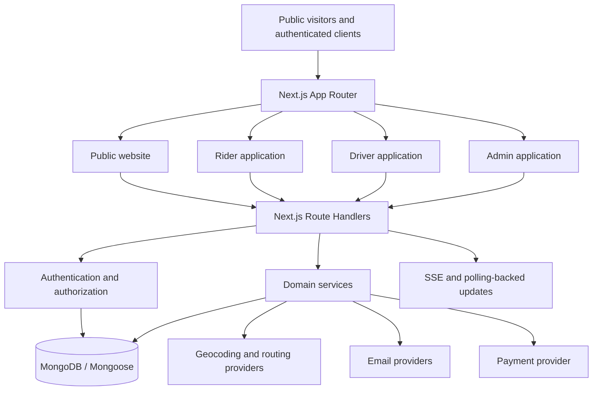

# BHAVO — Everyday Mobility, Made Smarter

**BHAVO** is an India-focused mobility platform designed to simplify everyday transportation through on-demand rides, scheduled daily commutes, and pet-friendly travel.

Unlike conventional ride-booking platforms that primarily focus on individual trips, BHAVO brings multiple everyday transportation needs together in one platform.

### What Makes BHAVO Special?

- **Everyday Rides:** Book rides conveniently for your daily travel needs.
- **Daily Commutes:** Schedule recurring journeys for students and working professionals, reducing the need to book the same route every day.
- **Pet Rides:** Find compatible transportation for journeys with your pets through pet-friendly driver preferences.
- **Smart Driver Matching:** Match ride requirements with driver availability, location, vehicle compatibility, and verification status.
- **Real-Time Ride Tracking:** Follow ride progress and receive journey updates.
- **Unified Management:** Connect riders, drivers, and administrators through dedicated dashboards and shared backend services.

### The Problem We Solve

Regular travellers often repeat the same booking process every day, while pet owners face additional challenges finding suitable transportation. Drivers also need a more structured way to receive compatible ride requests.

BHAVO addresses these challenges by combining individual ride booking, recurring commute planning, and pet-friendly transportation within one coordinated mobility platform.

### Our Vision

To make everyday transportation more convenient, organized, and accessible by building a mobility platform that adapts to people's routines—not just individual journeys.

**BHAVO — Everyday Mobility, Made Smarter.**
---


## 1. Product Overview

BHAVO is intended to make regular transportation easier to plan and manage. Its core product idea combines three ride experiences:

1. **Everyday Rides** — A rider requests transportation for an individual journey.
2. **Daily Commutes** — A rider saves a recurring schedule, such as a weekday college or office journey, instead of entering the same details repeatedly.
3. **Pet Rides** — A rider requests a journey that requires a pet-compatible driver and vehicle.

The platform has four application surfaces:

- **Public Website:** Introduces BHAVO, explains its services, and provides entry points to booking, sign-in, driver onboarding, and support.
- **Rider Experience:** Supports booking, recurring commute management, trip tracking, saved places, profile/settings, support, and related account pages.
- **Driver Experience:** Supports driver operations such as duty status, dispatch offers, trip actions, vehicle/document information, earnings views, ratings, and support.
- **Internal Admin Experience:** Provides operational visibility and administrative controls for rides, recurring commutes, drivers, riders, support, payments, and audit records.

The application is built as a single Next.js codebase. The public site, rider pages, driver pages, admin pages, and their API handlers are organized within the same project rather than separate frontend and backend repositories.

### Product Principles

- Real persisted application data should be used for operational decisions and dashboard metrics.
- The server, not the browser, is authoritative for identity, permissions, ride state, and fare calculations.
- Recurring commute schedules and the individual ride occurrences created from them are different domain records.
- A driver must satisfy account, document, vehicle, duty, location, and ride-availability requirements before receiving or accepting an eligible ride.
- Cash collected physically by a driver must not be represented as money received by BHAVO or credited to a platform wallet merely because collection was recorded.
- Online payment status must be verified server-side; a browser redirect or client callback is not proof of payment.
- Operational failures should be shown honestly. Empty results and provider failures must not be replaced with fabricated riders, rides, reviews, payments, or statistics.

---

## 2. Product Experiences

### 2.1 Public Website

The public website is served from the Next.js App Router. The root route `/` renders the landing page through:

`src/components/public-website/landing-page/LandingPage.tsx`

In the reviewed source snapshot, the homepage composition includes:

1. Hero
2. Fleet / mobility section
3. Daily Commutes
4. Pet Rides
5. Drive with BHAVO
6. Frequently Asked Questions
7. Final Call to Action
8. Footer

The repository also contains reusable public sections for services, contact, about, app preview, how-it-works, reviews, terms, and Why BHAVO. Not every available section component is currently rendered on the homepage. The public website is being planned for a fuller section-by-section redesign; see [Current Product Scope and Planned Work](#22-current-product-scope-and-planned-work).

### 2.2 Rider Experience

Rider routes currently include:

- Dashboard and booking entry points.
- Everyday ride booking.
- Trip history and ride details.
- Recurring commute management.
- Saved places.
- Profile and settings.
- Wallet view.
- Mobility insights.
- Notifications.
- Support.

Rider state is coordinated through Zustand stores under `src/hooks/user/`. The main dashboard store handles dashboard data and active-ride update behavior.

### 2.3 Driver Experience

Driver routes currently include:

- Driver dashboard.
- Active trip and dispatch interactions.
- Trips/history.
- Earnings.
- Incentives.
- Ratings.
- Vehicle and document information.
- Settings and duty controls.
- Support.

Driver client state is managed in:

`src/hooks/driver/useDriverStore.ts`

The driver domain includes duty states such as:

- `OFFLINE`
- `ONLINE_SEARCHING`
- `DISPATCH_ALERT`
- `ON_TRIP`

### 2.4 Internal Admin Experience

The current admin route structure contains these areas:

- Overview.
- Live Operations.
- Daily Commutes.
- All Rides and ride details.
- Drivers and document review.
- Riders and rider details.
- Support and safety tickets.
- Payments.
- Audit logs.
- User administration.

Admin pages are under `src/app/admin/`, reusable views are under `src/components/admin/`, and administrative API handlers are under `src/app/api/admin/`.

The admin interface is intended for BHAVO's internal team. It is not currently an organization portal for colleges or companies to manage their own student/employee accounts or commute programs.

---

## 3. Roles and Access Model

The User model defines these role values:

| Role | Intended Purpose |
|---|---|
| `RIDER` | A customer who books rides and manages recurring commutes. |
| `DRIVER` | A driver who completes onboarding, satisfies eligibility requirements, receives dispatch offers, and performs rides. |
| `ADMIN` | An internal administrator who operates and reviews the platform. |
| `USER` | A legacy role value that appears in compatibility handling and should be treated carefully during migration/authorization review. |

The account status values in the User model are:

- `ACTIVE`
- `SUSPENDED`
- `DISABLED`

The authentication helpers in `src/lib/auth.ts` provide session/token functions and role checks. Protected application areas use the shared authorization helpers and the Next.js proxy boundary.

**Important security rule:** public registration must not let a caller assign privileged roles by submitting a role field. Driver eligibility is separate from having a driver account: an account must satisfy the actual compliance and dispatch requirements. Admin access must only be granted through a trusted administrative process.

The current Google authentication route needs a security correction before production (see [Known Limitations](#23-known-limitations-and-production-readiness-work)): the reviewed code accepts a client-requested `DRIVER` role when creating a new Google-authenticated account. Do not treat the intended role policy as fully enforced until that code path is fixed and tested.

---

## 4. Core Workflows

### 4.1 Everyday Ride Booking

The general ride flow represented by the current API and domain code is:

1. The rider selects pickup and drop-off locations.
2. The client obtains address and coordinate information using the configured location/routing integrations.
3. The application requests a server-side fare estimate using `/api/rides/estimate`.
4. An authenticated rider submits a booking to `POST /api/user/rides`.
5. The server validates the rider session, coordinates, vehicle category, and fare inputs.
6. The server creates a Ride record with the initial `SEARCHING` state.
7. Dispatch logic identifies and offers the ride to eligible drivers.
8. The assigned driver progresses the ride through the ride lifecycle.
9. The rider can follow ride information through the rider APIs and stream endpoint.

The current ride status values include:

`SEARCHING` → `ACCEPTED` → `ARRIVED` → `IN_PROGRESS` → `COMPLETED`

`CANCELLED` is a terminal outcome subject to the transition rules in `src/lib/rideStateMachine.ts`. Clients must not be allowed to set arbitrary ride states directly.

**Fare caveat:** the current pricing engine calculates fare on the server in integer paise and applies a rate card and pet surcharge. However, the reviewed implementation can accept a client-provided claimed route distance within plausibility bounds; otherwise it derives an estimate from the pickup/drop-off geodesic distance. This is not the same as the server independently verifying an authoritative road route. Review and resolve this limitation before relying on fare integrity for live commercial rides.

### 4.2 Daily Commutes and Recurring Bookings

A recurring commute is a saved rider schedule. It is not itself a Ride record.

The core concepts are:

- **Commute:** The recurring schedule and its preferences (owner, title, pickup, destination, time, weekdays, vehicle type, and supported options).
- **AutoBookingOccurrence:** A specific expected occurrence of a commute at a particular scheduled date/time.
- **Ride:** The individual ride record materialized from an occurrence.
- **Dispatch:** The later process that finds and offers that ride to eligible drivers.

The current auto-booking implementation includes stable occurrence keys, unique constraints, lease information, retry counters, error state, and recovery logic. These mechanisms are intended to protect against duplicate materialization when multiple worker runs overlap or a worker fails partway through a batch.

The configured defaults distinguish two separate windows:

- **Materialization lookahead:** 180 minutes (T−180 by default).
- **Scheduled driver dispatch lead time:** 60 minutes (T−60 by default).

Materializing a future Ride record must not be confused with starting driver dispatch. Preserve this separation when changing recurring commute behavior.

Occurrence states represented in the model include:

- `PENDING`
- `CLAIMED`
- `MATERIALIZED`
- `FAILED_RETRYABLE`
- `FAILED_PERMANENT`
- `SKIPPED_PAST`
- `SKIPPED_PAUSED`

### 4.3 Driver Eligibility and Dispatch

Driver matching is not simply a search for the nearest online account. The shared eligibility code evaluates requirements including:

- Driver account status and role.
- Document compliance.
- Driver online/duty state.
- Current active ride/driver reservation.
- Vehicle compatibility.
- Pet-friendly preference when the ride requires it.
- Driver coordinate validity and freshness.
- Configured dispatch radius.
- Previous rejection/offer state where applicable.

Dispatch and ranking code is located in:

- `src/lib/driverEligibility.ts`
- `src/lib/dispatchRanking.ts`
- Related services.

Offer expiration and dispatch maintenance are handled by backend logic. A driver should not receive an incompatible or stale offer, and concurrent attempts to accept the same ride must be guarded by database-level conditional updates.

### 4.4 Pet-Friendly Rides

Pet compatibility is part of ride/driver matching. The Ride model records a pet-friendly requirement, and driver settings include a pet-friendly preference. The eligibility helper rejects a pet-required ride when the driver has not opted into pet compatibility.

The initial public product scope is a pet-friendly ride option and corresponding availability/eligibility behavior. It should not imply that all drivers or vehicles accept pets.

**Important:** the current User schema defaults the driver pet-friendly setting to `true`. That default is unsafe for a real opt-in capability and must be corrected so a driver is pet-compatible only after explicit consent. Existing records should be audited before changing defaults or migrating data.

### 4.5 Support Tickets

The Ticket model represents a support case associated with a user. It includes a ticket ID, category, subject, description, status, priority, and resolution notes. Admin and driver support routes provide operational access to ticket-related workflows.

The current ticket status values are:

- `OPEN`
- `IN_PROGRESS`
- `RESOLVED`
- `CLOSED`

Support history must reflect actual submissions and administrative actions. Do not create fake welcome tickets, synthetic responses, unsupported assignment claims, or fabricated resolution notes.

---

## 5. Technical Architecture

BHAVO is a full-stack Next.js application. Pages and API handlers are deployed as one application codebase; MongoDB is the shared persistence layer.



### Architectural Layers

| Layer | Location | Responsibility |
|---|---|---|
| App Router | `src/app/` | Public pages, rider/driver/admin pages, and server API route handlers. |
| UI Components | `src/components/` | Page composition, dashboards, dialogs, forms, maps, and reusable presentation. |
| Client State | `src/hooks/` | Zustand stores for rider and driver client state. |
| Domain Services | `src/lib/` | Authentication, ride state machine, pricing, dispatch, eligibility, recurring bookings, payments, ledger, email, and utilities. |
| Database Models | `src/models/` | Mongoose schemas and persistence definitions. |
| Static Assets | `public/` | Logos, wordmarks, images, and public assets. |
| Tests | `tests/` | Automated regression tests for domain behavior, API/security boundaries, concurrency, payments, dispatch, and workflows. |

### Server-Side Domain Services

The most important shared services include:

- `auth.ts` — JWT signing/verification, session extraction, role requirements, and cookie options.
- `mongoose.ts` — Cached Mongoose connection per Node.js process.
- `rideStateMachine.ts` — Ride transition rules and concurrency-aware ride operations.
- `pricingEngine.ts` — Rate cards, coordinate validation, fare calculation, and pricing snapshots.
- `driverCompliance.ts` — Required driver-document definitions and compliance checks.
- `driverEligibility.ts` — Driver and vehicle eligibility checks.
- `dispatchRanking.ts` — Offer selection, ranking/dispatch helpers, and expired-offer maintenance.
- `recurrenceEngine.ts` — Recurring schedule calculation and occurrence keys.
- `autoBooking.ts` — Occurrence claiming, materialization, leases, retries, and batch processing.
- `paymentService.ts` — Razorpay order and payment confirmation/status operations.
- `razorpayClient.ts` — Provider API requests and signature verification helpers.
- `ledgerService.ts` — Financial transaction recording and idempotency helpers.
- `adminAudit.ts` — Administrative audit-record creation.
- `runtimeConfig.ts` — Runtime configuration and payment/secret checks.
- `rateLimit.ts` — Currently process-local rate-limit implementations.
- `rideTracking.ts` — SSE message and keepalive helpers.
- `email.ts` and `resend.ts` — OTP email and contact-notification delivery.

---

## 6. Technology Stack

The package manifest in the reviewed archive specifies the following main technologies and libraries:

| Technology | Use in BHAVO |
|---|---|
| Next.js `16.2.11` | Application framework and App Router. |
| React `19.2.4` | UI rendering. |
| TypeScript | Application and domain types; strict compiler mode is enabled. |
| MongoDB | Primary persistent database. |
| Mongoose `9.9.3` | MongoDB schemas, models, queries, and indexes. |
| Zustand `5.x` | Rider and driver client state stores. |
| TanStack React Query `5.x` | Available data-fetching/cache dependency; inspect actual usage before expanding its role. |
| Firebase `13.x` | Firebase Web SDK used for Google sign-in. |
| `jose` | JWT/session token operations. |
| `bcryptjs` | Password hashing. |
| Zod `4.x` | Request/form validation schemas where used. |
| Leaflet and React Leaflet | Map rendering. |
| Framer Motion | UI animation. |
| Lucide React | Icons. |
| Tailwind CSS `4.x` | Utility styling. |
| Base UI / local UI components | Accessible UI primitives and project-specific controls. |
| Nodemailer | SMTP email delivery. |
| Resend SDK | Contact-form email notifications, with SMTP fallback. |
| Node.js crypto / Web Crypto | Random identifiers, OTP generation, and cryptographic signatures. |

The exact versions are controlled by `package.json` and `package-lock.json`. Use the lockfile when installing dependencies.

---

## 7. Repository Structure

The following is the main structure of the reviewed repository. It is a functional map, not an exhaustive listing of every file.

```text
BHAVO/
├── public/                         # Logos, wordmarks and static assets
├── scripts/
│   ├── deployIndexes.ts            # Create/verify application indexes
│   └── run-tests.cjs               # Discovers and executes *.test.ts files
├── docs/
│   └── engineering/                # Architecture, audit, API, security and test notes
├── tests/                           # Automated tests
├── src/
│   ├── app/
│   │   ├── (main)/                 # Public informational pages
│   │   ├── admin/                  # Internal admin pages
│   │   ├── api/                    # Next.js API route handlers
│   │   │   ├── admin/
│   │   │   ├── auth/
│   │   │   ├── cron/
│   │   │   ├── driver/
│   │   │   ├── health/
│   │   │   ├── location/
│   │   │   ├── payments/
│   │   │   ├── places/
│   │   │   ├── rides/
│   │   │   ├── user/
│   │   │   └── webhooks/
│   │   ├── driver/                 # Driver pages
│   │   ├── user/                   # Rider pages
│   │   ├── login/                  # Login page
│   │   ├── signup/                 # Registration page
│   │   ├── globals.css
│   │   ├── layout.tsx
│   │   └── page.tsx                # Public homepage
│   ├── components/
│   │   ├── admin/
│   │   ├── auth/
│   │   ├── driver/
│   │   ├── public-website/
│   │   ├── ui/
│   │   └── user/
│   ├── hooks/
│   │   ├── driver/
│   │   └── user/
│   ├── lib/                        # Shared domain/integration services
│   ├── models/                     # Mongoose models
│   └── proxy.ts                    # Request proxy / protected-route boundary
├── .gitignore
├── AGENTS.md                       # Repository-specific Next.js agent guidance
├── eslint.config.mjs
├── next.config.ts
├── package.json
├── package-lock.json
├── postcss.config.mjs
├── tsconfig.json
└── vercel.json
```

---

## 8. Application Routes

### 8.1 Public Pages

| Route | Purpose |
|---|---|
| `/` | Main public landing page. |
| `/about` | About BHAVO. |
| `/blog` | Blog page. |
| `/contact` | Contact page and enquiry form. |
| `/features` | Product features. |
| `/how-it-works` | Explanation of the ride flow. |
| `/our-services` | Service overview. |
| `/reviews` | Reviews page; current implementation presents an honest empty state while verified feedback is collected. |
| `/why-us` | Why BHAVO. |
| `/terms-and-policies` | Terms and privacy content. |
| `/terms` | Redirects to the terms anchor on `/terms-and-policies`. |
| `/privacy` | Redirects to the privacy anchor on `/terms-and-policies`. |

### 8.2 Authentication Pages

| Route | Purpose |
|---|---|
| `/login` | Login interface. |
| `/signup` | Registration interface. |

### 8.3 Rider Pages

| Route | Purpose |
|---|---|
| `/user/dashboard` | Rider dashboard. |
| `/user/book-ride` | Ride booking. |
| `/user/trips` | Trip history and ride information. |
| `/user/my-commute` | Recurring commute management. |
| `/user/places` | Saved places. |
| `/user/profile` | Rider profile. |
| `/user/settings` | Rider settings. |
| `/user/wallet` | Wallet view. Availability of wallet spending must not be inferred from the existence of this page. |
| `/user/mobility-insights` | Mobility insight view. |
| `/user/notifications` | Notifications view. |
| `/user/support` | Rider support. |

### 8.4 Driver Pages

| Route | Purpose |
|---|---|
| `/driver` | Driver dashboard. |
| `/driver/trips` | Driver trips. |
| `/driver/earnings` | Earnings view. |
| `/driver/incentives` | Incentives view; a visible page does not imply that incentive payments are enabled. |
| `/driver/ratings` | Driver ratings. |
| `/driver/vehicle` | Vehicle and document information. |
| `/driver/settings` | Driver settings. |
| `/driver/support` | Driver support. |

### 8.5 Admin Pages

| Route | Purpose |
|---|---|
| `/admin` | Operational overview. |
| `/admin/live-operations` | Current ride and dispatch monitoring. |
| `/admin/commutes` | Recurring commute administration. |
| `/admin/commutes/[id]` | Commute detail. |
| `/admin/rides` | Ride search and operations. |
| `/admin/rides/[id]` | Ride detail. |
| `/admin/drivers` | Driver directory and compliance review. |
| `/admin/drivers/[id]` | Driver detail. |
| `/admin/riders` | Rider directory. |
| `/admin/riders/[id]` | Rider detail. |
| `/admin/users` | User administration. |
| `/admin/support` | Support and safety queue. |
| `/admin/payments` | Payment records and monitoring. |
| `/admin/audit-logs` | Administrative audit events. |

---

## 9. API Reference

The following is a grouped route inventory from the reviewed source. Check the route handler before relying on a particular HTTP method or response shape; not every route supports every method.

### 9.1 Authentication

| Endpoint | Method(s) in source | Purpose |
|---|---|---|
| `/api/auth/register` | `POST` | Local registration. |
| `/api/auth/login` | `POST` | Local login. |
| `/api/auth/logout` | `POST` | Clear the BHAVO session. |
| `/api/auth/forgot-password` | `POST` | Request password-reset verification. |
| `/api/auth/verify-otp` | `POST` | Verify email/password-reset OTP. |
| `/api/auth/reset-password` | `POST` | Complete password reset. |
| `/api/auth/google` | `POST` | Exchange/verify Google or Firebase identity information for a BHAVO session. |

Phone-number + SMS OTP authentication is **not implemented** in the reviewed source. It is a future product decision, not a current capability.

### 9.2 Public and Shared Endpoints

| Endpoint | Method(s) | Purpose |
|---|---|---|
| `/api/contact` | `POST` | Validate and deliver a public contact enquiry by email. |
| `/api/places` | `GET` | Geocoding, reverse geocoding, and place search/nearby information using the configured public map-data service. |
| `/api/location/detect` | `GET` | Location-related detection endpoint. |
| `/api/rides/estimate` | `GET`, `POST` | Calculate fare estimates from coordinates and supported vehicle/pricing inputs. |
| `/api/health` | `GET` | General application/configuration status summary. |
| `/api/health/liveness` | `GET` | Liveness endpoint. |
| `/api/health/readiness` | `GET` | Database readiness/health endpoint. |

### 9.3 Rider Endpoints

| Endpoint | Method(s) | Purpose |
|---|---|---|
| `/api/user/dashboard` | `GET` | Rider dashboard data. |
| `/api/user/profile` | `GET`, `PATCH` | Rider profile retrieval/update. |
| `/api/user/rides` | `GET`, `POST` | List rides and create a ride. |
| `/api/user/rides/[id]` | `GET`, `PATCH` | Retrieve a ride and perform supported rider actions. |
| `/api/user/rides/[id]/messages` | `GET`, `POST` | Ride chat history and messages. |
| `/api/user/rides/[id]/stream` | `GET` | Rider-authorized ride event stream. |
| `/api/user/rides/[id]/payment/order` | `POST` | Create/reuse a provider order for an eligible completed ride. |
| `/api/user/rides/[id]/payment/verify` | `POST` | Verify and confirm an online payment. |
| `/api/user/rides/[id]/payment/status` | `GET` | Retrieve payment status. |
| `/api/user/commutes` | `GET`, `POST`, `PATCH`, `DELETE` | List and manage recurring commute schedules. |
| `/api/user/places` | `GET`, `POST`, `PATCH`, `DELETE` | Manage saved places. |
| `/api/user/tickets` | `GET`, `POST` | List and create support tickets. |

### 9.4 Driver Endpoints

| Endpoint | Method(s) | Purpose |
|---|---|---|
| `/api/driver/dashboard` | `GET` | Driver dashboard data. |
| `/api/driver/dispatches` | `GET`, `POST` | Retrieve and act on driver dispatch offers. |
| `/api/driver/dispatches/maintenance` | `GET`, `POST` | Protected expired-offer maintenance job. |
| `/api/driver/duty` | `GET`, `POST` | Driver duty state. |
| `/api/driver/rides` | `POST` | Driver ride lifecycle actions. |
| `/api/driver/rides/[id]/cash` | `POST` | Record supported cash-collection confirmation. |
| `/api/driver/rides/[id]/messages` | `GET`, `POST` | Driver ride chat. |
| `/api/driver/rides/[id]/stream` | `GET` | Driver-authorized ride event stream. |
| `/api/driver/trips` | `GET` | Driver trip history. |
| `/api/driver/earnings` | `GET`, `POST` | Driver earnings operations exposed by the current handler. Do not infer that bank payouts/cashouts are enabled. |
| `/api/driver/incentives` | `GET`, `POST` | Incentive-related interface/API. Do not infer that incentive credits are enabled. |
| `/api/driver/ratings` | `GET` | Driver rating information. |
| `/api/driver/settings` | `GET`, `POST` | Driver settings. |
| `/api/driver/support` | `GET`, `POST` | Driver support operations. |
| `/api/driver/vehicle` | `GET`, `PATCH` | Vehicle and document-related information. |

### 9.5 Admin Endpoints

Admin handlers are under `/api/admin/` and use the shared admin authorization helper in the reviewed source.

| Endpoint | Method(s) | Purpose |
|---|---|---|
| `/api/admin/overview` | `GET` | Admin overview metrics. |
| `/api/admin/live-operations` | `GET` | Live operations records/summary. |
| `/api/admin/stream` | `GET` | Admin operational SSE snapshot stream. |
| `/api/admin/commutes` | `GET` | Recurring commute list. |
| `/api/admin/commutes/[id]` | `GET`, `PATCH` | Commute detail and supported administrative updates. |
| `/api/admin/rides` | `GET` | Ride search/list. |
| `/api/admin/rides/[id]` | `GET` | Ride detail. |
| `/api/admin/drivers` | `GET` | Driver list and filters. |
| `/api/admin/drivers/[id]` | `GET` | Driver detail. |
| `/api/admin/drivers/[id]/documents` | `POST` | Document review action. |
| `/api/admin/riders` | `GET` | Rider list. |
| `/api/admin/riders/[id]` | `GET`, `PATCH` | Rider detail and supported administrative update. |
| `/api/admin/users` | `GET` | User search/list. |
| `/api/admin/users/[id]` | `GET` | User detail. |
| `/api/admin/users/[id]/status` | `POST` | Supported user status action. |
| `/api/admin/support` | `GET` | Support queue. |
| `/api/admin/support/[id]` | `GET`, `PATCH` | Ticket detail and supported status/action updates. |
| `/api/admin/payments` | `GET` | Payment/transaction monitoring. |
| `/api/admin/audit-logs` | `GET` | Administrative audit history. |

### 9.6 Payments, Webhooks, and Background Jobs

| Endpoint | Method(s) | Purpose |
|---|---|---|
| `/api/webhooks/razorpay` | `POST` | Razorpay webhook receiver. |
| `/api/payments/razorpay/webhook` | `POST` | Alias to the Razorpay webhook handler. |
| `/api/cron/auto-booking` | `GET`, `POST` | Protected recurring commute materialization worker endpoint. |
| `/api/driver/dispatches/maintenance` | `GET`, `POST` | Protected expired-dispatch maintenance endpoint. |

Cron endpoints require the configured `CRON_SECRET` using either `Authorization: Bearer <secret>` or the `x-cron-secret` header.

---

## 10. Data Model Overview

The main Mongoose models in `src/models/` are:

| Model | Purpose | Important Concepts |
|---|---|---|
| `User` | Rider, driver, and admin identity/account data. | Role, account status, authentication provider, session token version, profile, driver duty, vehicle, settings, location, documents, and wallet-related fields. |
| `Ride` | An individual ride. | Rider, driver, pickup/drop-off, vehicle type, fare, pricing snapshot, status, OTP, payment state, dispatch offer, messages, scheduled time, and commute occurrence reference. |
| `Commute` | A rider's recurring schedule. | Rider, title, route, preferred time, weekdays, vehicle type, active/paused state, payment preference and generation metadata. |
| `AutoBookingOccurrence` | A single expected instance of a recurring schedule. | Unique occurrence key, commute, rider, scheduled time, state, ride reference, lease, attempt count and error details. |
| `Transaction` | Financial/ledger event. | Unique idempotency key, actor, event type, direction, amount in paise, currency, related entity, status, and metadata. |
| `Ticket` | Support case. | User, ticket ID, category, subject, description, status, priority and resolution notes. |
| `Place` | Saved rider place. | User ownership and saved location information. |
| `AdminAuditLog` | Administrative action history. | Actor, action, target type/ID, reason, before/after snapshots, metadata, IP, user agent, and timestamp. |

### Important Domain Distinctions

- A **Commute** is not a Ride.
- An **AutoBookingOccurrence** is not a Ride; it tracks the generation of an individual scheduled occurrence.
- A Ride's lifecycle status is not the same as its payment status.
- A payment being verified is not necessarily the same as the driver's bank settlement being complete.
- Physical cash collection is not an electronic platform-wallet credit.
- Driver online status is not identical to driver eligibility.

### Driver Document Categories

The current compliance utility defines eight document/requirement records:

1. Driving License (DL)
2. Identity Proof
3. Bank Account Details
4. Profile Photo
5. Vehicle Registration Certificate (RC)
6. Vehicle Insurance
7. Pollution Under Control (PUC) Certificate
8. Helmets / safety gear verification

The reviewed code currently contains fabricated `VERIFIED` sample document defaults. These are a known high-priority defect and must not be treated as genuine driver evidence. See [Known Limitations](#23-known-limitations-and-production-readiness-work).

---

## 11. Real-Time Behavior

BHAVO uses a combination of Server-Sent Events (SSE), database-backed snapshots, and client polling.

### Rider and Driver Ride Updates

- Rider and driver ride stream endpoints exist under their respective ride routes.
- Streams use explicit SSE event formatting and keepalive helpers.
- Client code subscribes to ride updates and refreshes data as events arrive.
- Some driver dispatch and dashboard interactions also use periodic polling.

### Admin Updates

- `/api/admin/stream` provides an authenticated operational stream.
- The current implementation obtains operational counts from MongoDB and periodically compares snapshots.
- The stream is polling-backed; it is not a distributed event broker or a direct database change-stream architecture.

### Current Limitations

- A polling-backed SSE stream can observe persisted changes made through another application instance because instances share MongoDB, but changes are only observed on the next poll.
- Polling frequency creates database load and affects freshness.
- Some client-side polling intervals and in-memory stream state are local to the process/browser that owns them.
- The admin snapshot includes a changing timestamp in the comparison payload, which can make snapshots appear changed even when the underlying operational counts have not changed. This should be corrected to avoid unnecessary updates.

Do not describe the current implementation as instantaneous event-driven real-time delivery. It is more accurately described as **near-real-time updates using SSE with database polling and client polling fallbacks**.

---

## 12. Payments and Financial Model

### 12.1 Current Payment Implementation

The repository contains a Razorpay checkout integration with:

- Server-side payment order creation for eligible completed rides.
- INR currency and integer-paise amounts.
- Checkout signature verification.
- Provider-side payment-status lookup.
- Raw-body webhook signature verification.
- Payment state updates on the Ride record.
- Transaction ledger records with deterministic idempotency keys.
- Cash-collection recording through the driver flow.
- Cash and online settlement safeguards in the payment service.

The payment service requires a completed ride before creating an online payment order. It checks rider/ride ownership, authoritative fare, payment state, provider order, currency, amount, and captured status before confirming payment.

### 12.2 Current Payment States and Money Handling

The Ride model contains payment methods such as:

- `WALLET`
- `CASH`
- `UPI`
- `ONLINE`

Payment states include:

- `PENDING`
- `PAID`
- `PENDING_COLLECTION`
- `COLLECTED`
- `PENDING_PAYMENT`
- `FAILED`

The Transaction model represents financial events in integer paise and has `CREDIT`, `DEBIT`, and `NON_MONETARY_RECORD` directions, with statuses including `PENDING`, `SETTLED`, `FAILED`, and `REVERSED`.

**Do not infer that every payment-method enum is commercially enabled.** The product's current cash-first policy and the implementation's payment defaults/gates need to be kept aligned. The reviewed Ride schema and ride-creation handler still contain `WALLET` defaults, while the broader product decision is cash-first. This mismatch requires correction before production use.

### 12.3 What Is Not Implemented Yet

The current Razorpay integration is a conventional collection/verification flow. The reviewed code does **not** implement marketplace split payouts through Razorpay Route or Cashfree Easy Split.

The following are future payment-product decisions, not current capabilities:

- BHAVO percentage commission allocation per completed ride.
- Driver linked-account onboarding with a marketplace provider.
- Automated transfer of the driver's share.
- Provider transfer webhooks and transfer reconciliation.
- Bank settlement-state tracking for split payouts.
- Cash commission collection and reconciliation policy.

The intended business model discussed for BHAVO is:

1. A ride is completed.
2. The rider pays online.
3. BHAVO verifies the payment with the provider and persists it idempotently.
4. A server-calculated percentage commission is allocated to BHAVO.
5. The remaining share is transferred to the driver only after payment verification.
6. Provider transfer and bank settlement are tracked separately.

The exact commission rate, commission base, gateway-fee allocation, and cash reconciliation policy have not yet been finalized. Do not calculate or promise driver split payouts until a provider product is approved and those policies are implemented.

### 12.4 Live-Payment Gate

`LIVE_PAYMENTS_ENABLED` must be explicitly set to `true` before the current Razorpay order service considers online payments enabled, and the Razorpay key ID and secret must be configured. The webhook handler separately requires `RAZORPAY_WEBHOOK_SECRET`.

The current enablement helper does not itself require the webhook secret before returning enabled. Therefore, **do not enable online payments until the webhook secret and full callback/verification flow are configured and tested as well**.

Keep live payments disabled by default. Test credentials, if used, must remain separate from live credentials and production data.

---

## 13. Maps, Routing, and Location Services

The current source uses the following location-related technologies/integrations:

| Technology / Service | Role |
|---|---|
| OpenStreetMap data | Map tile source and open mapping data. |
| Nominatim | Address search, reverse geocoding, and nearby place lookup via the server-side places route. |
| Project OSRM | Road route geometry/distance/duration integration referenced by the booking experience and architecture notes. |
| Leaflet / React Leaflet | Interactive map and marker rendering. |
| Browser Geolocation API | Current-device location when the browser grants permission. |

### Service Limitations

Public Nominatim, OSRM demo, and OpenStreetMap tile services are not a guaranteed commercial infrastructure service. They have usage policies, capacity limits, and no BHAVO-specific uptime SLA. The code includes process-local caching for places queries; that cache is not shared between server instances.

Before public commercial traffic grows, review provider policies, attribution requirements, rate limits, reliability, and whether a contracted or self-hosted mapping/routing service is needed. Do not assume that a publicly accessible endpoint is an unlimited free production service.

---

## 14. Authentication and Identity Providers

### 14.1 Local Email/Password Authentication

The application includes local registration and login APIs. Passwords are hashed with `bcryptjs`. Session tokens are created/verified through the shared `jose`-based authentication helpers and are transported in HTTP-only cookies using the shared cookie configuration.

The authentication API also includes an email OTP-based password-reset flow. This is not phone-number/SMS OTP login.

### 14.2 Google Sign-In Using Firebase

The frontend Firebase helper in `src/lib/firebase.ts` initializes the Firebase Web SDK and uses `GoogleAuthProvider` with popup sign-in. The Google provider must be enabled in Firebase Authentication, and the application domains must be configured in Firebase's authorized-domain settings.

The client sends Firebase/Google identity tokens to `POST /api/auth/google`. The current server route validates token information using Google/Firebase HTTP endpoints, finds or creates a MongoDB User, then issues the existing BHAVO session.

The reviewed implementation does not use the Firebase Admin SDK for token verification. The Google account and Firebase project configuration must be treated as external prerequisites.

**Security item to fix:** the current Google route allows a client-requested `DRIVER` role for a newly created account and includes a non-production client-provided identity fallback when token verification fails. Those behaviors must be removed or tightly isolated and tested before production. A public Google signup should not grant driver or admin privileges based on a client-supplied role.

### 14.3 Phone + OTP

Phone-number login/signup with SMS OTP is a planned future feature. It is not implemented in the reviewed source. A development-only test OTP flow and production SMS provider integration must be designed separately; no real SMS service should be assumed to exist today.

---

## 15. Environment Configuration

The reviewed archive does not include `.env`, `.env.local`, or `.env.example`. The `.gitignore` contains `.env*`, so environment files are intended to remain out of version control.

Create a local `.env.local` file in the project root. Use genuine values only in your local secret store or hosting provider. Never commit passwords, private keys, database credentials, provider secrets, or production tokens.

### 15.1 Configuration Template

The following is a **placeholder template**, not a working credential set:

```dotenv
# Runtime
# Next.js normally sets NODE_ENV automatically.
NODE_ENV=development

# MongoDB
DATABASE_URL="mongodb://127.0.0.1:27017/bhavo"
MONGODB_MAX_POOL_SIZE=20
MONGODB_MIN_POOL_SIZE=2

# BHAVO session/authentication secrets
# Generate unique random values. Do not use the example placeholders in production.
JWT_SECRET="replace-with-a-unique-random-secret-of-at-least-32-characters"
# AUTH_SECRET is an alternative fallback if JWT_SECRET is not set.
# AUTH_SECRET="replace-with-a-different-unique-random-secret"

# Protected background job endpoints
CRON_SECRET="replace-with-a-unique-random-cron-secret-of-at-least-32-characters"

# Dispatch behavior
RIDE_DISPATCH_LEAD_TIME_MINUTES=60
DISPATCH_OFFER_TTL_SECONDS=25
DISPATCH_MAX_RADIUS_KM=10
DISPATCH_MAX_ATTEMPTS=8
DRIVER_LOCATION_MAX_AGE_SECONDS=120

# Recurring commute materialization
AUTO_BOOKING_LOOKAHEAD_MINUTES=180
AUTO_BOOKING_BATCH_SIZE=50

# SMTP for email OTP/password-reset delivery
SMTP_HOST="smtp.example.com"
SMTP_PORT=465
SMTP_SECURE=true
SMTP_USER="your-smtp-user"
SMTP_PASS="your-smtp-password"
EMAIL_FROM="BHAVO <no-reply@example.com>"

# Resend for public contact-form notifications (optional if SMTP fallback is configured)
RESEND_API_KEY=""
RESEND_FROM_EMAIL="BHAVO Support <support@your-verified-domain.example>"
CONTACT_NOTIFICATION_EMAIL="support@your-domain.example"

# Firebase Web app configuration for Google sign-in
NEXT_PUBLIC_FIREBASE_API_KEY=""
NEXT_PUBLIC_FIREBASE_AUTH_DOMAIN=""
NEXT_PUBLIC_FIREBASE_PROJECT_ID=""
NEXT_PUBLIC_FIREBASE_STORAGE_BUCKET=""
NEXT_PUBLIC_FIREBASE_MESSAGING_SENDER_ID=""
NEXT_PUBLIC_FIREBASE_APP_ID=""
NEXT_PUBLIC_FIREBASE_MEASUREMENT_ID=""

# Optional Google OAuth audience configuration used by the Google auth route
GOOGLE_CLIENT_ID=""
NEXT_PUBLIC_GOOGLE_CLIENT_ID=""

# Razorpay: keep disabled until credentials, webhook and end-to-end checks are ready
LIVE_PAYMENTS_ENABLED=false
RAZORPAY_KEY_ID=""
RAZORPAY_KEY_SECRET=""
RAZORPAY_WEBHOOK_SECRET=""
```

### 15.2 Variable Reference

| Variable | Required? | Purpose / Notes |
|---|---|---|
| `DATABASE_URL` | Yes | MongoDB connection string. The Mongoose connector requires it. Local format may be `mongodb://...`; hosted clusters commonly use `mongodb+srv://...`. |
| `JWT_SECRET` | Yes for authentication | Primary JWT signing secret. `AUTH_SECRET` is a fallback if `JWT_SECRET` is not supplied. Use a unique random value; production validation expects at least 32 characters and rejects known placeholders. |
| `AUTH_SECRET` | Alternative | Fallback JWT secret when `JWT_SECRET` is absent. Prefer one clearly managed canonical secret across all instances. |
| `CRON_SECRET` | Yes for protected jobs | Shared secret for auto-booking and dispatch-maintenance job endpoints. Production validation expects a strong secret of at least 32 characters. |
| `MONGODB_MAX_POOL_SIZE` | Optional | Mongoose connection pool maximum; source default is 20. Configure with total instance count in mind. |
| `MONGODB_MIN_POOL_SIZE` | Optional | Mongoose connection pool minimum; source default is 2. |
| `NODE_ENV` | Framework-managed | Normally set by Next.js/runtime. Use `development`, `test`, or `production` as appropriate. |
| `RIDE_DISPATCH_LEAD_TIME_MINUTES` | Optional | Scheduled ride dispatch lead time; default 60 minutes. |
| `DISPATCH_OFFER_TTL_SECONDS` | Optional | Driver offer expiry; default 25 seconds. |
| `DISPATCH_MAX_RADIUS_KM` | Optional | Dispatch candidate radius; default 10 km. |
| `DISPATCH_MAX_ATTEMPTS` | Optional | Maximum dispatch attempt count; default 8. |
| `DRIVER_LOCATION_MAX_AGE_SECONDS` | Optional | Maximum permitted location age for dispatch eligibility; default 120 seconds. |
| `AUTO_BOOKING_LOOKAHEAD_MINUTES` | Optional | Recurring commute materialization lookahead; default 180 minutes and must be at least the dispatch lead time. |
| `AUTO_BOOKING_BATCH_SIZE` | Optional | Maximum batch size; default 50, supported range 1–200. |
| `SMTP_HOST` | Required for SMTP email delivery | SMTP server host. |
| `SMTP_PORT` | Required for configured SMTP | SMTP port; `465` commonly uses secure TLS in the current helper. |
| `SMTP_SECURE` | Optional | Set `true` for secure SMTP as required by the provider. |
| `SMTP_USER` | Required for SMTP email delivery | SMTP account username. |
| `SMTP_PASS` | Required for SMTP email delivery | SMTP password/app password. Keep server-side only. |
| `EMAIL_FROM` | Optional | Sender identity for SMTP email. |
| `RESEND_API_KEY` | Optional | Resend API credential for contact notifications. Keep server-side only. |
| `RESEND_FROM_EMAIL` | Optional | Verified sender identity for Resend. The source has a development/provider fallback; configure a sender on a domain you control for production. |
| `CONTACT_NOTIFICATION_EMAIL` | Optional but recommended | Recipient for website contact submissions. The source has a built-in fallback recipient; configure this explicitly for the actual BHAVO support mailbox. |
| `NEXT_PUBLIC_FIREBASE_API_KEY` | Required for Firebase client initialization | Firebase Web app API key. It is a client configuration value, not a server secret; still configure Firebase authorized domains and provider security correctly. |
| `NEXT_PUBLIC_FIREBASE_AUTH_DOMAIN` | Firebase Web configuration | Firebase authentication domain. |
| `NEXT_PUBLIC_FIREBASE_PROJECT_ID` | Required for Firebase client initialization | Firebase project ID. |
| `NEXT_PUBLIC_FIREBASE_STORAGE_BUCKET` | Firebase Web configuration | Storage bucket value from Firebase app settings. |
| `NEXT_PUBLIC_FIREBASE_MESSAGING_SENDER_ID` | Firebase Web configuration | Firebase messaging sender ID. |
| `NEXT_PUBLIC_FIREBASE_APP_ID` | Firebase Web configuration | Firebase application ID. |
| `NEXT_PUBLIC_FIREBASE_MEASUREMENT_ID` | Optional | Firebase measurement ID if Analytics is configured. |
| `GOOGLE_CLIENT_ID` | Optional / integration-dependent | Server-side Google client ID value used by the Google auth route's audience check. Review enforcement behavior before production. |
| `NEXT_PUBLIC_GOOGLE_CLIENT_ID` | Optional / integration-dependent | Public Google client ID configuration used by the Google auth route. Never put a client secret in a `NEXT_PUBLIC_` variable. |
| `LIVE_PAYMENTS_ENABLED` | No; default should be false | Explicit gate for online payment order functionality. Do not enable until all Razorpay credentials and verification flows are configured and tested. |
| `RAZORPAY_KEY_ID` | Required when enabling Razorpay | Razorpay API key ID. Use test credentials for test-mode validation and live credentials only after approval. |
| `RAZORPAY_KEY_SECRET` | Required when enabling Razorpay | Server-only Razorpay key secret. Never expose to the browser or commit it. |
| `RAZORPAY_WEBHOOK_SECRET` | Required for webhook verification | Secret configured for the Razorpay webhook endpoint. The payment enablement helper does not itself enforce its presence, so verify it separately before enabling payments. |

### 15.3 Secret Handling

- Do not commit `.env`, `.env.local`, or real credentials.
- Do not prefix private credentials with `NEXT_PUBLIC_`.
- Use separate credentials for local development, provider test mode, staging, and production.
- All application instances must receive the same relevant session and cron secrets for a given environment.
- Rotate compromised credentials and invalidate affected sessions where applicable.
- Do not paste real credentials into issue trackers, chat messages, test fixtures, or README files.

---

## 16. Local Development Setup

### Prerequisites

- Git
- Node.js version supported by the installed Next.js 16 release
- npm
- A local MongoDB instance or a MongoDB cluster you are authorized to use
- Optional provider accounts/configuration for email, Firebase Google sign-in, maps, and Razorpay tests

### 16.1 Obtain the Project

```bash
git clone <your-bhavo-repository-url>
cd <repository-folder>
```

If you already have the repository, open its root directory instead.

### 16.2 Install Dependencies

Use the lockfile to install reproducible dependencies:

```bash
npm ci
```

### 16.3 Configure Environment

Create `.env.local` in the repository root using the template in [Environment Configuration](#15-environment-configuration).

At minimum, configure:

- `DATABASE_URL`
- `JWT_SECRET` or `AUTH_SECRET`
- `CRON_SECRET` if testing protected worker endpoints

Email, Google sign-in, and Razorpay require their own provider configuration if those flows are being tested.

### 16.4 Start MongoDB

Ensure the configured MongoDB instance is running and reachable from the application. Use a local development database rather than production data when developing or testing.

### 16.5 Start the Development Server

```bash
npm run dev
```

The `dev` script runs Next.js using the Webpack development mode configured in `package.json`.

Open:

```text
http://localhost:3000
```

### 16.6 Optional: Synchronize Model Indexes

After confirming `DATABASE_URL` points to the intended development database:

```bash
npm run db:indexes
```

This command connects to MongoDB and calls `createIndexes()` for the application models. It creates/synchronizes model-declared indexes; run it deliberately against the correct database, especially in shared environments.

---

## 17. Available Commands

The following scripts are defined in the reviewed `package.json`:

| Command | Purpose |
|---|---|
| `npm run dev` | Start Next.js development server using `next dev --webpack`. |
| `npm run dev:turbo` | Start the Next.js development server using the default command `next dev`. |
| `npm run build` | Create the Next.js production build. |
| `npm start` | Serve the production build with `next start`; run after a successful build. |
| `npm run lint` | Run ESLint using the repository configuration. |
| `npm test` | Discover and execute all `tests/**/*.test.ts` files using Node's test runner and `tsx`. |
| `npm run test:smoke` | Execute `tests/e2e-ride-journey.test.ts` through `tsx --test`. |
| `npx tsc --noEmit` | Run TypeScript type checking. This command is not currently exposed as a named package script. |
| `npm run db:indexes` | Create and verify indexes declared by the Mongoose models. |

A successful test run or build should be recorded with the command, environment, and result. Do not copy historical test counts from old engineering reports as proof that the current working tree passes.

---

## 18. Background Jobs and Scheduled Processing

The codebase exposes protected endpoints for recurring commute materialization and expired-dispatch maintenance:

- `GET` or `POST /api/cron/auto-booking`
- `GET` or `POST /api/driver/dispatches/maintenance`

Both validate the shared `CRON_SECRET` through `src/lib/cronAuth.ts`. Provide the secret through either:

```http
Authorization: Bearer <CRON_SECRET>
```

or:

```http
x-cron-secret: <CRON_SECRET>
```

The auto-booking endpoint processes a bounded batch using the configured lookahead and batch-size defaults. The maintenance endpoint sweeps expired dispatch offers.

**Scheduling is external to the application code.** In the reviewed archive, `vercel.json` contains only the Vercel schema reference and does not declare cron schedules. A hosting scheduler or authorized external scheduler must be configured separately when the platform is deployed. Do not assume these endpoints run automatically merely because they exist.

The recurring booking and dispatch jobs must remain idempotent and safe under overlapping invocations. The unique occurrence key and lease/retry mechanisms are central safeguards.

---

## 19. Multi-Instance Architecture Considerations

BHAVO is intended to support multiple application instances. The desired model is multiple stateless Next.js application processes sharing the same authoritative MongoDB data, with consistent secret/configuration values.

### Existing Foundations

- Mongoose connection reuse is cached in `globalThis` within each Node.js process.
- Ride transitions and driver reservations use conditional database operations in shared domain services.
- Recurring commute occurrences use stable unique keys and lease records.
- Financial transaction records use idempotency keys and unique indexes.
- Auth sessions carry a token version checked against persisted user state.
- SSE handlers read shared persisted state through server-side queries.

### Current Multi-Instance Limitations

- `rateLimit.ts` implements in-memory rate limiters. Counters are per process, not globally shared across instances.
- Nominatim query caching uses a process-local `Map`, so each instance has its own cache.
- The Mongoose cache is per process. Each instance maintains its own connection pool; total MongoDB connections increase with instance count.
- Real-time delivery is polling-backed rather than based on a shared pub/sub event bus. This can work across instances through MongoDB visibility, but freshness and database load depend on polling intervals and instance/request behavior.
- Client-side intervals and local UI state do not become shared server state.
- The reviewed archive does not include an executed multi-instance load-test report.

### Multi-Instance Acceptance Principles

Any future change to BHAVO should preserve these rules:

1. MongoDB remains the source of truth for persisted application state.
2. No critical business rule depends solely on an in-memory variable on one server.
3. Ride assignment and driver active-ride reservation remain atomic.
4. Payment and ledger operations remain idempotent under duplicate/concurrent requests.
5. Recurring commute generation remains protected by unique occurrence keys and leases.
6. Authentication secrets and cron secrets are consistent across instances in the same environment.
7. Rate-limiting requirements are evaluated for global enforcement where necessary.
8. Uploaded documents and other persistent files must not depend on ephemeral per-instance local storage.
9. Real-time updates must reflect persisted changes regardless of which instance processed the write.
10. Connection pool sizing must be considered across the total number of application instances.

Redis, a message broker, or another shared service should not be introduced automatically. Add infrastructure only when a measured or clearly defined requirement justifies it.

---

## 20. Testing and Verification

The repository contains a `tests/` directory with TypeScript test files and a custom runner at `scripts/run-tests.cjs`.

The current test inventory covers areas including:

- Authentication, session cookies, token revocation, and role security.
- Driver authorization and document-verification security.
- Ride ownership, state transitions, and concurrent driver acceptance.
- Driver location and eligibility.
- Dispatch offers, ranking, expiry, and isolation.
- Pricing integrity and financial exploit guards.
- Cash collection and transaction-ledger idempotency.
- Razorpay payment signatures and payment lifecycle.
- Recurring commute recurrence, occurrence materialization, leases, and recovery.
- Rider/driver ride journeys and SSE tracking.
- Admin operations and platform verification.
- Contact, rate limiting, and production-readiness helpers.

### Recommended Verification Sequence

```bash
npm test
npm run test:smoke
npx tsc --noEmit
npm run lint
npm run build
git diff --check
```

Run the checks after meaningful changes and before merging code. Also perform targeted manual/integration checks for external providers and multi-instance behavior where needed.

**Verification note for this README:** the source archive was inspected to document the project. The full test suite, type-check, lint, production build, live MongoDB behavior, provider payment flow, and multi-instance behavior were not executed as part of generating this README. No pass/fail claim is made here.

---

## 21. Security and Engineering Principles

The following rules should guide all changes to BHAVO.

### Authentication and Authorization

- The server establishes the authenticated identity; never trust rider/driver/admin IDs supplied by the client for ownership decisions.
- Validate role and account status on protected API routes.
- Public account creation must not grant admin or driver privileges through a request-body role field.
- Revoke sessions when supported account suspension or token-version changes occur.
- Keep cookies HTTP-only and use secure cookie settings in production.
- Do not leak OTPs, passwords, tokens, secrets, or private provider responses through logs or API output.

### Ride and Dispatch Integrity

- Use the central ride state machine for lifecycle changes.
- Verify rider ownership and driver assignment for ride-specific endpoints.
- Keep driver active-ride reservation consistent with ride assignment.
- Validate location coordinate ranges and timestamps.
- Reject stale or incompatible driver candidates.
- Preserve atomic updates for concurrent acceptance and state transitions.

### Financial Integrity

- Store money in integer paise.
- Calculate fares on the server.
- Verify payment signatures and provider-side payment state.
- Treat provider webhooks as untrusted until signature validation succeeds.
- Use idempotency keys for ledger and webhook processing.
- Keep cash collection separate from platform-held online funds.
- Do not add refunds, commissions, wallet spending, cashouts, incentives, or marketplace splits without explicit policy and complete backend implementation.

### Data Quality

- Do not seed fake records during normal user authentication, page views, or API reads.
- Empty states must remain empty when no real records exist.
- Test fixtures belong in tests or explicitly isolated development tooling.
- Never display fictional driver documents, phone numbers, ratings, coordinates, testimonials, or payment records as real data.
- Do not replace API/database failures with fabricated successful responses.

### Change Discipline

- Inspect current code before editing.
- Make scoped changes and preserve existing user modifications.
- Reuse domain services rather than duplicating business logic in UI components.
- Add regression tests for security, money, concurrency, and lifecycle changes.
- Review the complete diff before accepting a change.

---

## 22. Current Product Scope and Planned Work

The following reflects the product decisions discussed for BHAVO. It is not a claim that every item is already implemented.

### Current Product Direction

- India-first ride booking using INR.
- Everyday/on-demand ride requests.
- Individual recurring commute schedules for students and employees.
- Pet-friendly ride requests subject to actual driver and vehicle compatibility.
- Rider, driver, and internal admin experiences.
- Email/password authentication and Google sign-in integration.
- Cash-first operational policy while online payments remain gated.

### Planned Work Discussed

- Redesign and complete the public website section by section.
- Build a distinct app-like mobile presentation for the public website and authentication pages while preserving desktop presentation.
- Improve rider dashboard correctness and user experience.
- Improve driver dashboard correctness and user experience.
- Improve the internal admin dashboard and operational detail.
- Plan phone-number + SMS OTP authentication later; it is not current functionality.
- Evaluate marketplace payment splitting: percentage-based BHAVO commission and driver transfer after verified payment for a completed ride. Provider selection, pricing, commission basis, linked-account onboarding, and cash reconciliation policy remain open.
- Conduct a dedicated multi-instance compatibility audit later. Multi-instance behavior is a design requirement, but full distributed/load verification has not been established in this archive.

### Current Order of Product Work

1. Public website.
2. Rider dashboard.
3. Driver dashboard.
4. Admin dashboard.
5. Revisit broader multi-instance verification and deployment/operations work when explicitly scheduled.

Phase 9 — DevOps + Observability has intentionally been skipped in the project plan. Do not silently treat it as completed or start deployment work as part of unrelated feature tasks.

---

## 23. Known Limitations and Production-Readiness Work

This section is deliberately explicit. These are issues visible in the reviewed source or requirements that have not yet been fully implemented/verified. They should be resolved before relying on BHAVO for commercial live operations.

### 23.1 Driver Verification Defaults

`src/lib/driverCompliance.ts` contains a `DEFAULT_DRIVER_DOCUMENTS` list with sample document IDs and `VERIFIED` statuses. `syncDriverDocuments()` returns these sample records when a driver's document list is missing/empty. The User schema also defaults the driver-document array to sample values.

This is not valid production evidence. Replace sample evidence with document definitions whose initial state is missing/pending, and calculate compliance only from real submitted records plus actual admin review. Review existing database records before any migration.

### 23.2 Fabricated User Defaults

The reviewed User schema includes defaults for a sample phone number, sample emergency contacts, a sample pet profile, a five-star rating, Delhi driver coordinates, pet-friendly driver preference, and sample pre-verified driver documents.

These are not safe production defaults for personal or operational information. Optional profile details should be unset until the user supplies them; coordinates should only be considered valid after a real location update; pet compatibility should require explicit driver opt-in; ratings should be derived from genuine ratings.

### 23.3 Google Sign-In Role Handling

The current `/api/auth/google` route derives a requested role from the request body and uses it when creating a new user. A new account can therefore be created with `DRIVER` when the client submits that value. The route also has a non-production fallback that accepts client-provided identity fields when token verification fails.

Public registration must not grant privileged roles through client input. Remove or tightly isolate the fallback, enforce token audience/issuer/expiry verification appropriately, and force public new-account creation to the allowed public role. Driver onboarding and admin provisioning must remain separate trusted processes.

### 23.4 Ride/Payment Defaults and Pricing Inputs

The reviewed Ride schema and ride-creation route default the payment method to `WALLET`, while the current product decision is cash-first and wallet spending/online payments are restricted. The route also accepts several method enum values and normalizes unknown values. Align model defaults, API validation, UI options, and the actual enabled payment policy before live use.

The pricing engine is server-side and stores paise, but it accepts a client-supplied claimed distance when that value passes geodesic plausibility bounds. For stronger fare integrity, use a trusted routing result or controlled server-side distance calculation, and verify that the backend is not relying on a client-controlled route distance for the final charge.

### 23.5 Synthetic Chat/Support Content

The reviewed ride creation handler writes an initial rider chat message automatically. The rider and driver message routes also need a strict audit to ensure empty chat reads do not create synthetic counterpart messages and one side cannot access a ride that is not assigned/owned by it. The user ticket GET route and ticket creation path should likewise be checked for fake welcome tickets and unsupported assignment/resolution claims.

Only real messages and real support actions should be persisted or represented as having happened.

### 23.6 Process-Local Rate Limiting

`src/lib/rateLimit.ts` stores counters in an in-memory `Map`. Each application instance has independent counters. This is not global abuse protection across a multi-instance deployment. Sensitive authentication and OTP operations need a shared enforcement design or other appropriately persistent controls before distributed production operation.

### 23.7 Email Delivery Configuration

Password-reset OTP delivery uses SMTP via Nodemailer. Contact notifications prefer Resend and fall back to SMTP. Local development code logs OTP data to the console when not in production; keep development isolated and never expose OTPs in production responses or logs. Configure a real verified sender and explicit support recipient before using the public contact form commercially.

### 23.8 Maps and Public Routing Services

The current public Nominatim/OSRM/OSM services are subject to provider usage policies and do not provide a BHAVO-specific commercial SLA. Review caching, request rates, attribution, availability and commercial terms before launch.

### 23.9 Marketplace Split Payments Are Not Implemented

The code includes ordinary Razorpay payment order creation and verification. It does not currently implement Razorpay Route or Cashfree Easy Split linked-account onboarding, percentage commission allocation, automated driver transfers, transfer webhooks, or settlement reconciliation.

Do not advertise or enable automatic BHAVO/driver fare splitting until the marketplace provider account is approved and the full process is implemented and verified. The cash-ride commission reconciliation policy also remains undefined.

### 23.10 Real-Time and Multi-Instance Limitations

The admin SSE stream polls database counts and currently includes a timestamp in its snapshot comparison. Rate limits and the Nominatim cache are process-local. Full behavior under concurrently running application instances and realistic load has not been verified in the reviewed archive.

### 23.11 Background Scheduler Configuration

The cron endpoints exist and are protected by `CRON_SECRET`, but the reviewed `vercel.json` contains no schedule declarations. The required external scheduler registration is a deployment/operations prerequisite and must be documented when that work is resumed.

### 23.12 Automated Test Execution Is Not Certification

The repository contains many regression tests, but their presence does not prove a clean build, passing suite, valid live provider setup, or safe production deployment. Run the current tests and perform external-service and concurrency verification in the actual target environment.

---

## 24. Contributing and Change Workflow

BHAVO changes should be made deliberately and with a clear understanding of existing behavior.

### Recommended Workflow

1. Inspect the current branch, working tree, and relevant implementation.
2. Identify the actual defect or product requirement.
3. Map affected UI components, API handlers, services, models, environment variables, and tests.
4. Write a scoped implementation plan before broad changes.
5. Preserve existing user modifications and avoid unrelated formatting or refactoring.
6. Implement at the correct layer: domain rules in server-side services, persistence in models/database operations, and presentation in components.
7. Add regression tests for changed behavior and relevant security/financial invariants.
8. Run targeted tests, the full test suite, TypeScript, lint, and build where possible.
9. Inspect the final Git diff and report any checks that were not run.

### Guidelines for AI Coding Agents

- Do not invent APIs, provider configuration, test results, metrics, customer reviews, or business policies.
- Do not claim a feature is complete because a button or page exists.
- Do not remove tests to make a command pass.
- Do not rewrite large files solely to reduce line count; refactor by responsibility.
- Do not modify database state or run index/migration commands against production without explicit approval.
- Do not expose secrets in generated documentation, logs, screenshots, or API responses.
- Do not implement a new commission, refund, cancellation, incentive, payout, or safety policy without an explicit product decision.

---

## 25. Useful Engineering Documentation

The repository contains additional engineering documents under `docs/engineering/`, including:

- `API-INVENTORY.md` — API route inventory and notes.
- `CURRENT-ARCHITECTURE.md` — architecture overview and data-flow notes.
- `DATA-MODEL-AUDIT.md` — model and persistence review.
- `PHASE-0-AUDIT.md` — initial audit findings.
- `PHASE-1A-AUTH-RESULT.md` and `PHASE-1A-FOLLOWUP.md` — authentication work records.
- `PHASE-1B-RIDE-RESULT.md` — ride lifecycle work record.
- `PHASE-1C-FINANCIAL-INTEGRITY-PLAN.md` — financial integrity planning.
- `PHASE-1D-DRIVER-DISPATCH-PLAN.md` — driver dispatch planning.
- `PHASE-1E-REALTIME-TRACKING-PLAN.md` — real-time tracking planning.
- `PHASE-1F-AUTO-BOOKING-WORKERS.md` — recurring commute worker notes.
- `PHASE-1H-ADMIN-OPERATIONS.md` — admin operations notes.
- `PHASE-1I-PRODUCTION-READINESS.md` — production readiness and operational notes.
- `PHASE-2-CONTROLLED-LAUNCH.md` — controlled launch guidance.
- `SCALABILITY-AUDIT.md` — scalability and multi-instance considerations.
- `SECURITY-AUDIT.md` — security review notes.
- `TESTING-GAPS.md` — testing coverage and known gaps.

These are engineering records, not substitutes for checking the current source. Some documents may describe earlier snapshots or planned changes. When a document conflicts with the current code, verify the code and update the documentation rather than assuming the older report is still accurate.

---

## Project Status Statement

BHAVO is an actively evolving ride-booking and recurring-commute platform. The repository contains substantial product and backend functionality, but the known limitations above mean the reviewed source should not be described as fully production-ready.

Treat live payments, marketplace driver payouts, document verification, synthetic data removal, distributed rate limiting, external job scheduling, and multi-instance verification as explicit engineering work—not assumptions.

**Build the platform around real users, real records, verified payments, clear operational states, and changes that can be tested and explained.**
