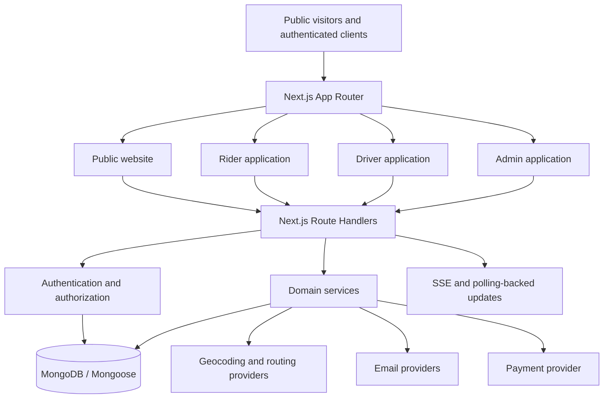

# BHAVO — Everyday Mobility, Made Smarter

**BHAVO** is an India-focused mobility platform designed to simplify everyday transportation through on-demand rides, scheduled daily commutes, and pet-friendly travel.

Unlike conventional ride-booking platforms that primarily focus on individual trips, BHAVO brings multiple everyday transportation needs together in one platform.

### What Makes BHAVO Special?

- **Everyday Rides:** Book rides conveniently for your daily travel needs.
- **Daily Commutes:** Schedule recurring journeys for students and working professionals, reducing the need to book the same route every day.
- **Pet Rides:** Find compatible transportation for journeys with your pets through pet-friendly driver preferences.
- **Smart Driver Matching:** Match ride requirements with driver availability, location, vehicle compatibility, and verification status.
- **Real-Time Ride Tracking:** Follow ride progress and receive journey updates.
- **Unified Management:** Connect riders, drivers, and administrators through dedicated dashboards and shared backend services.

### The Problem We Solve

Regular travellers often repeat the same booking process every day, while pet owners face additional challenges finding suitable transportation. Drivers also need a more structured way to receive compatible ride requests.

BHAVO addresses these challenges by combining individual ride booking, recurring commute planning, and pet-friendly transportation within one coordinated mobility platform.

### Our Vision

To make everyday transportation more convenient, organized, and accessible by building a mobility platform that adapts to people's routines—not just individual journeys.

**BHAVO — Everyday Mobility, Made Smarter.**
---


## 1. Product Overview

BHAVO is intended to make regular transportation easier to plan and manage. Its core product idea combines three ride experiences:

1. **Everyday Rides** — A rider requests transportation for an individual journey.
2. **Daily Commutes** — A rider saves a recurring schedule, such as a weekday college or office journey, instead of entering the same details repeatedly.
3. **Pet Rides** — A rider requests a journey that requires a pet-compatible driver and vehicle.

The platform has four application surfaces:

- **Public Website:** Introduces BHAVO, explains its services, and provides entry points to booking, sign-in, driver onboarding, and support.
- **Rider Experience:** Supports booking, recurring commute management, trip tracking, saved places, profile/settings, support, and related account pages.
- **Driver Experience:** Supports driver operations such as duty status, dispatch offers, trip actions, vehicle/document information, earnings views, ratings, and support.
- **Internal Admin Experience:** Provides operational visibility and administrative controls for rides, recurring commutes, drivers, riders, support, payments, and audit records.

The application is built as a single Next.js codebase. The public site, rider pages, driver pages, admin pages, and their API handlers are organized within the same project rather than separate frontend and backend repositories.

### Product Principles

- Real persisted application data should be used for operational decisions and dashboard metrics.
- The server, not the browser, is authoritative for identity, permissions, ride state, and fare calculations.
- Recurring commute schedules and the individual ride occurrences created from them are different domain records.
- A driver must satisfy account, document, vehicle, duty, location, and ride-availability requirements before receiving or accepting an eligible ride.
- Cash collected physically by a driver must not be represented as money received by BHAVO or credited to a platform wallet merely because collection was recorded.
- Online payment status must be verified server-side; a browser redirect or client callback is not proof of payment.
- Operational failures should be shown honestly. Empty results and provider failures must not be replaced with fabricated riders, rides, reviews, payments, or statistics.

---

## 2. Product Experiences

### 2.1 Public Website

The public website is served from the Next.js App Router. The root route `/` renders the landing page through:

`src/components/public-website/landing-page/LandingPage.tsx`

In the reviewed source snapshot, the homepage composition includes:

1. Hero
2. Fleet / mobility section
3. Daily Commutes
4. Pet Rides
5. Drive with BHAVO
6. Frequently Asked Questions
7. Final Call to Action
8. Footer

The repository also contains reusable public sections for services, contact, about, app preview, how-it-works, reviews, terms, and Why BHAVO. Not every available section component is currently rendered on the homepage. The public website is being planned for a fuller section-by-section redesign; see [Current Product Scope and Planned Work](#22-current-product-scope-and-planned-work).

### 2.2 Rider Experience

Rider routes currently include:

- Dashboard and booking entry points.
- Everyday ride booking.
- Trip history and ride details.
- Recurring commute management.
- Saved places.
- Profile and settings.
- Wallet view.
- Mobility insights.
- Notifications.
- Support.


### 2.3 Driver Experience

Driver routes currently include:

- Driver dashboard.
- Active trip and dispatch interactions.
- Trips/history.
- Earnings.
- Incentives.
- Ratings.
- Vehicle and document information.
- Settings and duty controls.
- Support.


### 2.4 Internal Admin Experience

The current admin route structure contains these areas:

- Overview.
- Live Operations.
- Daily Commutes.
- All Rides and ride details.
- Drivers and document review.
- Riders and rider details.
- Support and safety tickets.
- Payments.
- Audit logs.
- User administration.

Admin pages are under `src/app/admin/`, reusable views are under `src/components/admin/`, and administrative API handlers are under `src/app/api/admin/`.

The admin interface is intended for BHAVO's internal team. It is not currently an organization portal for colleges or companies to manage their own student/employee accounts or commute programs.

---

## 3. Roles and Access Model

The User model defines these role values:

| Role | Intended Purpose |
|---|---|
| `RIDER` | A customer who books rides and manages recurring commutes. |
| `DRIVER` | A driver who completes onboarding, satisfies eligibility requirements, receives dispatch offers, and performs rides. |
| `ADMIN` | An internal administrator who operates and reviews the platform. |
| `USER` | A legacy role value that appears in compatibility handling and should be treated carefully during migration/authorization review. |


---

## 4. Core Workflows

### 4.1 Everyday Ride Booking

The general ride flow represented by the current API and domain code is:

1. The rider selects pickup and drop-off locations.
2. The client obtains address and coordinate information using the configured location/routing integrations.
3. The application requests a server-side fare estimate using `/api/rides/estimate`.
4. An authenticated rider submits a booking to `POST /api/user/rides`.
5. The server validates the rider session, coordinates, vehicle category, and fare inputs.
6. The server creates a Ride record with the initial `SEARCHING` state.
7. Dispatch logic identifies and offers the ride to eligible drivers.
8. The assigned driver progresses the ride through the ride lifecycle.
9. The rider can follow ride information through the rider APIs and stream endpoint.


**Fare caveat:** the current pricing engine calculates fare on the server in integer paise and applies a rate card and pet surcharge. However, the reviewed implementation can accept a client-provided claimed route distance within plausibility bounds; otherwise it derives an estimate from the pickup/drop-off geodesic distance. This is not the same as the server independently verifying an authoritative road route. Review and resolve this limitation before relying on fare integrity for live commercial rides.

### 4.2 Daily Commutes and Recurring Bookings

A recurring commute is a saved rider schedule. It is not itself a Ride record.

The core concepts are:

- **Commute:** The recurring schedule and its preferences (owner, title, pickup, destination, time, weekdays, vehicle type, and supported options).
- **AutoBookingOccurrence:** A specific expected occurrence of a commute at a particular scheduled date/time.
- **Ride:** The individual ride record materialized from an occurrence.
- **Dispatch:** The later process that finds and offers that ride to eligible drivers.

The current auto-booking implementation includes stable occurrence keys, unique constraints, lease information, retry counters, error state, and recovery logic. These mechanisms are intended to protect against duplicate materialization when multiple worker runs overlap or a worker fails partway through a batch.

The configured defaults distinguish two separate windows:

- **Materialization lookahead:** 180 minutes (T−180 by default).
- **Scheduled driver dispatch lead time:** 60 minutes (T−60 by default).

Materializing a future Ride record must not be confused with starting driver dispatch. Preserve this separation when changing recurring commute behavior.


### 4.3 Driver Eligibility and Dispatch

Driver matching is not simply a search for the nearest online account. The shared eligibility code evaluates requirements including:

- Driver account status and role.
- Document compliance.
- Driver online/duty state.
- Current active ride/driver reservation.
- Vehicle compatibility.
- Pet-friendly preference when the ride requires it.
- Driver coordinate validity and freshness.
- Configured dispatch radius.
- Previous rejection/offer state where applicable.

Offer expiration and dispatch maintenance are handled by backend logic. A driver should not receive an incompatible or stale offer, and concurrent attempts to accept the same ride must be guarded by database-level conditional updates.

### 4.4 Pet-Friendly Rides

Pet compatibility is part of ride/driver matching. The Ride model records a pet-friendly requirement, and driver settings include a pet-friendly preference. The eligibility helper rejects a pet-required ride when the driver has not opted into pet compatibility.

The initial public product scope is a pet-friendly ride option and corresponding availability/eligibility behavior. It should not imply that all drivers or vehicles accept pets.

**Important:** the current User schema defaults the driver pet-friendly setting to `true`. That default is unsafe for a real opt-in capability and must be corrected so a driver is pet-compatible only after explicit consent. Existing records should be audited before changing defaults or migrating data.

### 4.5 Support Tickets

The Ticket model represents a support case associated with a user. It includes a ticket ID, category, subject, description, status, priority, and resolution notes. Admin and driver support routes provide operational access to ticket-related workflows.


Support history must reflect actual submissions and administrative actions. Do not create fake welcome tickets, synthetic responses, unsupported assignment claims, or fabricated resolution notes.

---

## 5. Technical Architecture

BHAVO is a full-stack Next.js application. Pages and API handlers are deployed as one application codebase; MongoDB is the shared persistence layer.



---

## 6. Technology Stack

The package manifest in the reviewed archive specifies the following main technologies and libraries:

| Technology | Use in BHAVO |
|---|---|
| Next.js `16.2.11` | Application framework and App Router. |
| React `19.2.4` | UI rendering. |
| TypeScript | Application and domain types; strict compiler mode is enabled. |
| MongoDB | Primary persistent database. |
| Mongoose `9.9.3` | MongoDB schemas, models, queries, and indexes. |
| Zustand `5.x` | Rider and driver client state stores. |
| TanStack React Query `5.x` | Available data-fetching/cache dependency; inspect actual usage before expanding its role. |
| Firebase `13.x` | Firebase Web SDK used for Google sign-in. |
| `jose` | JWT/session token operations. |
| `bcryptjs` | Password hashing. |
| Zod `4.x` | Request/form validation schemas where used. |
| Leaflet and React Leaflet | Map rendering. |
| Framer Motion | UI animation. |
| Lucide React | Icons. |
| Tailwind CSS `4.x` | Utility styling. |
| Base UI / local UI components | Accessible UI primitives and project-specific controls. |
| Nodemailer | SMTP email delivery. |
| Resend SDK | Contact-form email notifications, with SMTP fallback. |
| Node.js crypto / Web Crypto | Random identifiers, OTP generation, and cryptographic signatures. |

The exact versions are controlled by `package.json` and `package-lock.json`. Use the lockfile when installing dependencies.

---

## 7. Repository Structure

The following is the main structure of the reviewed repository. It is a functional map, not an exhaustive listing of every file.

```text
BHAVO/
├── public/                         # Logos, wordmarks and static assets
├── scripts/
│   ├── deployIndexes.ts            # Create/verify application indexes
│   └── run-tests.cjs               # Discovers and executes *.test.ts files
├── docs/
│   └── engineering/                # Architecture, audit, API, security and test notes
├── tests/                           # Automated tests
├── src/
│   ├── app/
│   │   ├── (main)/                 # Public informational pages
│   │   ├── admin/                  # Internal admin pages
│   │   ├── api/                    # Next.js API route handlers
│   │   │   ├── admin/
│   │   │   ├── auth/
│   │   │   ├── cron/
│   │   │   ├── driver/
│   │   │   ├── health/
│   │   │   ├── location/
│   │   │   ├── payments/
│   │   │   ├── places/
│   │   │   ├── rides/
│   │   │   ├── user/
│   │   │   └── webhooks/
│   │   ├── driver/                 # Driver pages
│   │   ├── user/                   # Rider pages
│   │   ├── login/                  # Login page
│   │   ├── signup/                 # Registration page
│   │   ├── globals.css
│   │   ├── layout.tsx
│   │   └── page.tsx                # Public homepage
│   ├── components/
│   │   ├── admin/
│   │   ├── auth/
│   │   ├── driver/
│   │   ├── public-website/
│   │   ├── ui/
│   │   └── user/
│   ├── hooks/
│   │   ├── driver/
│   │   └── user/
│   ├── lib/                        # Shared domain/integration services
│   ├── models/                     # Mongoose models
│   └── proxy.ts                    # Request proxy / protected-route boundary
├── .gitignore
├── AGENTS.md                       # Repository-specific Next.js agent guidance
├── eslint.config.mjs
├── next.config.ts
├── package.json
├── package-lock.json
├── postcss.config.mjs
├── tsconfig.json
└── vercel.json
```

---


## Project Status Statement

BHAVO is an actively evolving ride-booking and recurring-commute platform. The repository contains substantial product and backend functionality, but the known limitations above mean the reviewed source should not be described as fully production-ready.

Treat live payments, marketplace driver payouts, document verification, synthetic data removal, distributed rate limiting, external job scheduling, and multi-instance verification as explicit engineering work—not assumptions.

**Build the platform around real users, real records, verified payments, clear operational states, and changes that can be tested and explained.**
