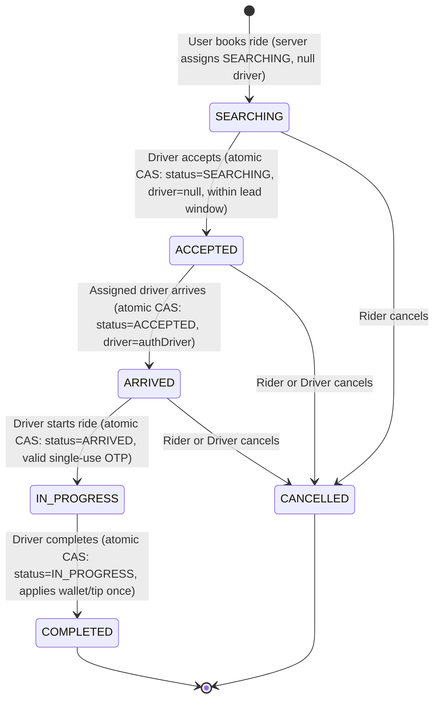

# Phase 1B: Ride State Machine, Trip Lifecycle & Concurrency Hardening Result

## 1. Executive Summary

Phase 1B hardens the shared ride lifecycle across both Passenger and Driver experiences in Bhavo. Prior to this phase, ride mutations (creation, acceptance, arrival, start, completion, and cancellation) were scattered across disparate route handlers, lacked atomic compare-and-swap (CAS) database primitives, trusted client-supplied statuses and identifiers, permitted arbitrary IDOR access across rider and driver endpoints, and suffered from race conditions under concurrent acceptance.

In Phase 1B, we established a single, authoritative, server-enforced state machine in [rideStateMachine.ts](file:///c:/Users/bhave/Bhavo/my-bhavo/src/lib/rideStateMachine.ts), backed by atomic MongoDB conditional updates (`findOneAndUpdate`), server-session ownership enforcement, strict OTP gating, and scheduled ride dispatch window validation. All 86 tests (13 test suites) pass with zero failures, and the Next.js production build succeeds with clean TypeScript and ESLint checks.

---

## 2. Current Ride Lifecycle Before Phase 1B

Prior to Phase 1B, the ride domain exhibited several critical vulnerabilities:
1. **Unconstrained Client Status Mutation:** `POST /api/user/rides` and `PATCH /api/user/rides/[id]` accepted caller-supplied `status`, allowing clients to create rides in `COMPLETED` or `ACCEPTED` states or assign arbitrary drivers.
2. **Race-Prone Read-Modify-Write Cycles:** Driver acceptance in `/api/driver/rides` fetched the ride, inspected `ride.status === 'SEARCHING'` in JavaScript memory, modified the in-memory object, and saved it. Two concurrent driver acceptances resulted in lost updates or double-assignment.
3. **IDOR Exposure:** Endpoints such as `/api/user/rides/[id]`, `/api/user/rides/[id]/messages`, `/api/user/rides/[id]/stream`, and `/api/driver/trips` trusted client-provided IDs or failed to enforce that the caller was the actual owner (`ride.rider === currentUser._id` or `ride.driver === currentDriver._id`).
4. **Premature Scheduled Ride Dispatch:** Future scheduled rides (e.g., rides booked for tomorrow) were immediately queryable and acceptable via `/api/driver/dispatches` as soon as their status was `SEARCHING`.
5. **Duplicate Mutation Side Effects:** Completing an already-completed ride or cancelling an already-cancelled ride did not fail deterministically, risking duplicate driver wallet credits or contradictory state transitions.

---

## 3. Target Ride Lifecycle

The canonical ride lifecycle is strictly enforced by the server:



### ASCII State Diagram
```text
  [ Client Ride Creation ]
             | (Server enforces initial state)
             v
        SEARCHING  -----------------------> [ CANCELLED ] (Rider)
             |
             | (Atomic CAS: driver=null, status=SEARCHING, leadWindow <= 30m)
             v
        ACCEPTED   -----------------------> [ CANCELLED ] (Rider or Assigned Driver)
             |
             | (Atomic CAS: driver=assignedDriver, status=ACCEPTED)
             v
        ARRIVED    -----------------------> [ CANCELLED ] (Rider or Assigned Driver)
             |
             | (Atomic CAS: driver=assignedDriver, status=ARRIVED, OTP matches)
             v
       IN_PROGRESS
             |
             | (Atomic CAS: driver=assignedDriver, status=IN_PROGRESS)
             v
        COMPLETED (Terminal)
```

---

## 4. State Transition Table

| Current State | Requested Transition | Allowed Actors | Required Conditions | Outcome |
| :--- | :--- | :--- | :--- | :--- |
| `SEARCHING` | `ACCEPTED` | Verified Driver | `driver == null`, within 30m dispatch window | `200 OK` (Atomic CAS) |
| `SEARCHING` | `CANCELLED` | Authenticated Rider | `rider == authUser._id` | `200 OK` (Atomic CAS) |
| `SEARCHING` | `ARRIVED` | Any | None | `409 Conflict` (`INVALID_TRANSITION`) |
| `SEARCHING` | `IN_PROGRESS` | Any | None | `409 Conflict` (`INVALID_TRANSITION`) |
| `SEARCHING` | `COMPLETED` | Any | None | `409 Conflict` (`INVALID_TRANSITION`) |
| `ACCEPTED` | `ARRIVED` | Assigned Driver | `driver == authUser._id` | `200 OK` (Atomic CAS) |
| `ACCEPTED` | `CANCELLED` | Rider or Assigned Driver | Must be assigned party | `200 OK` (Atomic CAS) |
| `ACCEPTED` | `IN_PROGRESS` | Any | Must be in `ARRIVED` state first | `409 Conflict` (`INVALID_TRANSITION`) |
| `ACCEPTED` | `COMPLETED` | Any | Must be `IN_PROGRESS` first | `409 Conflict` (`INVALID_TRANSITION`) |
| `ARRIVED` | `IN_PROGRESS` | Assigned Driver | `driver == authUser._id`, Valid OTP | `200 OK` (Atomic CAS) |
| `ARRIVED` | `CANCELLED` | Rider or Assigned Driver | Must be assigned party | `200 OK` (Atomic CAS) |
| `IN_PROGRESS` | `COMPLETED` | Assigned Driver | `driver == authUser._id` | `200 OK` (Atomic CAS, Financial side-effect once) |
| `IN_PROGRESS` | `CANCELLED` | Any | Trip is underway; cancellation disallowed | `409 Conflict` (`CANNOT_CANCEL_IN_PROGRESS`) |
| `COMPLETED` | Any | Any | Terminal state | `409 Conflict` (`ALREADY_COMPLETED`) |
| `CANCELLED` | Any | Any | Terminal state | `409 Conflict` (`ALREADY_CANCELLED`) |

---

## 5. Rider Permissions

- **Permitted Actions:**
  - Create ride for self (server guarantees `rider = session.id`, `status = SEARCHING`, `driver = null`, OTP generated server-side).
  - Read own ride details (`GET /api/user/rides/[id]` strictly verifies `ride.rider === session.id`).
  - Read own ride messages and telemetry streams (`/api/user/rides/[id]/messages`, `/api/user/rides/[id]/stream`).
  - Cancel own active ride while status is in `["SEARCHING", "ACCEPTED", "ARRIVED"]`.
- **Forbidden Actions:**
  - Cannot access or mutate another rider's ride (returns `404 Not Found` to prevent IDOR enumeration).
  - Cannot specify or override `status`, `driver`, `driverId`, or `rider` in creation payload.
  - Cannot trigger driver transitions (`ARRIVED`, `START`, `COMPLETE`).

---

## 6. Driver Permissions

- **Permitted Actions:**
  - View dispatches where `status = "SEARCHING"`, `driver = null`, and `scheduledFor <= Date.now() + 30 minutes`.
  - Accept eligible dispatch via atomic CAS.
  - Mark `ARRIVED` on assigned ride (`driver === session.id`).
  - Start trip (`IN_PROGRESS`) on assigned ride using valid rider OTP.
  - Complete trip (`COMPLETED`) on assigned ride, crediting driver earnings and tip atomically once.
  - Cancel assigned ride in `ACCEPTED` or `ARRIVED` state.
- **Forbidden Actions:**
  - Cannot accept a ride assigned to another driver or outside dispatch window.
  - Cannot mutate any ride not assigned to them (`403 Forbidden`).
  - Cannot spoof driver identity via request body or query parameter (`session.id` is authoritative).
  - Cannot advance transitions without satisfying prerequisite states and OTP validation.

---

## 7. Ownership Enforcement & IDOR Protection

All ride-related endpoints have been audited and updated:
1. `GET /api/user/rides/[id]`: Requires `requireRole(["RIDER", "USER"])`, validates `ride.rider.toString() === req.user._id.toString()`, returning `404 RIDE_NOT_FOUND` if mismatch.
2. `PATCH /api/user/rides/[id]`: Restricted to cancellation and rating. Cancellation delegates to `transitionToCancelledByRider()`. Rating is strictly rejected unless `ride.status === "COMPLETED"`.
3. `GET /api/user/rides/[id]/messages`: Validates rider ownership before querying chat records.
4. `GET /api/user/rides/[id]/stream`: Validates authenticated session and rider ownership prior to establishing Server-Sent Events stream.
5. `POST /api/driver/rides`: Validates `req.user.role === "DRIVER"`, resolves driver from session, and verifies `ride.driver.toString() === driverUser._id.toString()` for all non-accept transitions.
6. `GET /api/driver/trips`: Queries exclusively by `driver: req.user._id`.

---

## 8. Atomic Operations

All critical state transitions use MongoDB atomic conditional updates (`findOneAndUpdate`) with exact predicate conditions:

### Accept Ride
```typescript
Ride.findOneAndUpdate(
  {
    _id: rideId,
    status: "SEARCHING",
    driver: null,
    $or: [
      { scheduledFor: { $exists: false } },
      { scheduledFor: null },
      { scheduledFor: { $lte: maxAllowedScheduledFor } }
    ]
  },
  {
    $set: {
      driver: driverUser._id,
      status: "ACCEPTED",
      acceptedAt: atTime
    }
  },
  { new: true }
);
```

### Complete Ride
```typescript
Ride.findOneAndUpdate(
  {
    _id: rideId,
    status: "IN_PROGRESS",
    driver: driverUser._id
  },
  {
    $set: {
      status: "COMPLETED",
      completedAt: atTime,
      paymentStatus: "COMPLETED"
    }
  },
  { new: true }
);
```

### Cancel Ride (Rider)
```typescript
Ride.findOneAndUpdate(
  {
    _id: rideId,
    status: { $in: ["SEARCHING", "ACCEPTED", "ARRIVED"] },
    rider: riderId
  },
  {
    $set: {
      status: "CANCELLED",
      cancelledAt: atTime,
      cancelledBy: "RIDER",
      cancellationReason: reason
    }
  },
  { new: true }
);
```

---

## 9. Concurrency Strategy

Bhavo does **NOT** rely on process-local locks, in-memory mutexes, or server-bound locks. Concurrency control is completely delegated to the database tier via linearizable single-document atomic CAS operations in MongoDB:
- When two drivers simultaneously submit `action: "ACCEPT"` for the same ride:
  - Driver A's atomic query matches `{ status: "SEARCHING", driver: null }` and modifies the document.
  - Driver B's atomic query executes immediately after or concurrently; because the document now has `status: "ACCEPTED"` and `driver: Driver A`, Driver B matches zero documents.
  - The server inspects the existing ride state and returns `409 Conflict` with code `RIDE_ALREADY_ACCEPTED`.
  - Exactly one driver wins (200 OK) and all other concurrent attempts fail with 409 Conflict.
- When Rider `CANCEL` races with Driver `ACCEPT`:
  - If Rider `CANCEL` executes first, status becomes `CANCELLED`. Driver `ACCEPT` condition fails and returns 409 `RIDE_CANCELLED`.
  - If Driver `ACCEPT` executes first, status becomes `ACCEPTED` with driver assigned. Rider `CANCEL` then cancels the `ACCEPTED` ride and sets `cancelledBy: "RIDER"`.

---

## 10. Scheduled Ride Safety

- **Field Audit:** Bhavo uses `scheduledFor` on the `Ride` document.
- **Dispatch Lead Window:** Configurable via `RIDE_DISPATCH_LEAD_TIME_MINUTES` with a default of 60 minutes (`DEFAULT_DISPATCH_LEAD_TIME_MINUTES = 60`, `3,600,000 ms`).
- **Enforcement in Dispatches Query:** `GET /api/driver/dispatches` only returns rides where `scheduledFor <= Date.now() + getDispatchLeadTimeMs()` (or unscheduled on-demand rides).
- **Enforcement in State Machine:** `transitionToAccepted()` re-validates the dispatch window atomically inside the database condition:
  `{ $or: [{ scheduledFor: { $exists: false } }, { scheduledFor: null }, { scheduledFor: { $lte: maxAllowedScheduledFor } }] }`.
  Even if a driver attempts to accept a future scheduled ride by guessing the ID, the atomic update condition fails with 409 `SCHEDULED_RIDE_EARLY`.

### Scheduled Ride Dispatch Lead Time
- **Default:** 60 minutes (aligned with Bhavo's T-60 driver confirmation requirement).
- **Configurability:** Configured via the `RIDE_DISPATCH_LEAD_TIME_MINUTES` environment variable.
- **Validation:** Enforces a finite, positive integer (> 0). Invalid configurations (non-numeric, decimals such as `60.5`, zero, negative values, NaN) are strictly rejected with descriptive errors; values are safely converted to milliseconds (`getDispatchLeadTimeMs()`) only at domain boundaries.
- **Single Source of Truth:** Exactly one authoritative configuration source exists (`getDispatchLeadTimeMs()`). Both driver dispatch discovery (`/api/driver/dispatches`) and atomic driver acceptance (`transitionToAccepted()`) consume this same function.
- **Exact Boundary Behavior:** Boundary is evaluated deterministically as `scheduledFor <= now + leadTimeMs` (equivalently `now >= scheduledFor - leadTimeMs`). At exactly 60 minutes prior to pickup (e.g., 07:15 AM for an 08:15 AM pickup), the ride enters eligibility. At 61 minutes prior (07:14 AM), it is strictly rejected. Instant on-demand rides (`scheduledFor == null`) remain immediately dispatchable and completely unaffected.

---

## 11. Files Changed

1. [src/models/Ride.ts](file:///c:/Users/bhave/Bhavo/my-bhavo/src/models/Ride.ts)
   - Added lifecycle timestamps: `acceptedAt`, `arrivedAt`, `startedAt`, `completedAt`, `cancelledAt`, `cancelledBy`.
   - Added compound database indexes on `{ status: 1, driver: 1, scheduledFor: 1 }` and `{ rider: 1, status: 1 }`.
2. [src/lib/rideStateMachine.ts](file:///c:/Users/bhave/Bhavo/my-bhavo/src/lib/rideStateMachine.ts) (New)
   - Centralized transition map, dispatchability validator, typed `RideTransitionError`, and atomic transition functions (`transitionToAccepted`, `transitionToArrived`, `transitionToInProgress`, `transitionToCompleted`, `transitionToCancelledByRider`, `transitionToCancelledByDriver`).
3. [src/app/api/driver/rides/route.ts](file:///c:/Users/bhave/Bhavo/my-bhavo/src/app/api/driver/rides/route.ts)
   - Refactored driver actions to delegate strictly to `rideStateMachine`. Enforced driver identity strictly from session, eliminated read-modify-write race conditions.
4. [src/app/api/driver/dispatches/route.ts](file:///c:/Users/bhave/Bhavo/my-bhavo/src/app/api/driver/dispatches/route.ts)
   - Added query filtering for scheduled rides outside the 30-minute lead time and verified `driver: null`.
5. [src/app/api/user/rides/route.ts](file:///c:/Users/bhave/Bhavo/my-bhavo/src/app/api/user/rides/route.ts)
   - Enforced session-based rider identity, stripped client-supplied `status`, `driver`, `driverId`, and generated OTP server-side.
6. [src/app/api/user/rides/[id]/route.ts](file:///c:/Users/bhave/Bhavo/my-bhavo/src/app/api/user/rides/%5Bid%5D/route.ts)
   - Enforced rider ownership, delegated cancellations to `transitionToCancelledByRider()`, and blocked trip rating unless `status === "COMPLETED"`.
7. [src/app/api/user/rides/[id]/messages/route.ts](file:///c:/Users/bhave/Bhavo/my-bhavo/src/app/api/user/rides/%5Bid%5D/messages/route.ts)
   - Enforced rider ownership check before returning messages.
8. [src/app/api/user/rides/[id]/stream/route.ts](file:///c:/Users/bhave/Bhavo/my-bhavo/src/app/api/user/rides/%5Bid%5D/stream/route.ts)
   - Enforced rider authentication and ownership before establishing SSE telemetry connection.
9. [src/app/api/driver/trips/route.ts](file:///c:/Users/bhave/Bhavo/my-bhavo/src/app/api/driver/trips/route.ts)
   - Enforced session driver ownership and removed unused imports.
10. [src/app/api/user/dashboard/route.ts](file:///c:/Users/bhave/Bhavo/my-bhavo/src/app/api/user/dashboard/route.ts)
    - Enforced session rider ownership.
11. Test files added:
    - [tests/ride-state-machine.test.ts](file:///c:/Users/bhave/Bhavo/my-bhavo/tests/ride-state-machine.test.ts) (12 tests)
    - [tests/ride-ownership.test.ts](file:///c:/Users/bhave/Bhavo/my-bhavo/tests/ride-ownership.test.ts) (8 tests)
    - [tests/ride-concurrency.test.ts](file:///c:/Users/bhave/Bhavo/my-bhavo/tests/ride-concurrency.test.ts) (6 tests)
    - [tests/ride-scheduled-creation-otp.test.ts](file:///c:/Users/bhave/Bhavo/my-bhavo/tests/ride-scheduled-creation-otp.test.ts) (10 tests)

---

## 12. Tests Added

### State Machine Transition Tests (`tests/ride-state-machine.test.ts`)
- `Scenario 1: SEARCHING -> ACCEPTED succeeds`
- `Scenario 2: ACCEPTED -> ARRIVED succeeds`
- `Scenario 3: ARRIVED -> IN_PROGRESS succeeds with valid OTP`
- `Scenario 4: IN_PROGRESS -> COMPLETED succeeds`
- `Scenario 5: SEARCHING -> ARRIVED fails with 409 Conflict`
- `Scenario 6: SEARCHING -> IN_PROGRESS fails with 409 Conflict`
- `Scenario 7: SEARCHING -> COMPLETED fails with 409 Conflict`
- `Scenario 8: ACCEPTED -> COMPLETED fails with 409 Conflict`
- `Scenario 9: COMPLETED -> ACCEPTED fails with 409 Conflict`
- `Scenario 10: COMPLETED -> IN_PROGRESS fails with 409 Conflict`
- `Scenario 11: CANCELLED -> ACCEPTED fails with 409 Conflict`
- `Scenario 12: CANCELLED -> COMPLETED fails with 409 Conflict`

### Ride Ownership & IDOR Protection Tests (`tests/ride-ownership.test.ts`)
- `Scenario 13: Rider can read own ride`
- `Scenario 14: Rider cannot read another rider's ride (returns 404 IDOR protected)`
- `Scenario 15: Rider can cancel own eligible ride`
- `Scenario 16: Rider cannot cancel another rider's ride (returns 404 IDOR protected)`
- `Scenario 17: Driver can mutate assigned ride`
- `Scenario 18: Driver cannot mutate another driver's ride (returns 403 Forbidden)`
- `Scenario 19: Driver identity cannot be spoofed through request body`
- `Scenario 20: Rider identity cannot be spoofed through request body`

### Concurrency, Races & Duplicate Mutations (`tests/ride-concurrency.test.ts`)
- `Scenario 26 (Mandatory Concurrency): Two concurrent driver accept requests produce exactly one winner and one 409 conflict`
- `Scenario 21 & 27: Concurrent completion requests result in exactly one completion with non-duplicated financial side effects`
- `Scenario 22: Duplicate cancellation requests result in exactly one success and one 409 ALREADY_CANCELLED`
- `Scenario 24: Double acceptance by the same driver is deterministic (first wins, second 409 ALREADY_ACCEPTED)`
- `Scenario 25: Rider cancellation vs driver acceptance concurrent race produces deterministic atomic outcome`
- `Scenario 28: Completion vs Cancellation on an in-progress ride prevents cancellation once completed`

### Scheduled Ride Safety, Creation Security & OTP (`tests/ride-scheduled-creation-otp.test.ts`)
- `Scenario 29: Future scheduled ride (tomorrow) cannot be accepted before allowed dispatch window`
- `Scenario 30: Scheduled ride can be dispatched/accepted during its valid window (within 30 mins)`
- `Scenario 31: Client input attempting to force status=COMPLETED is stripped and forced to SEARCHING`
- `Scenario 32: Client input attempting to force status=ACCEPTED is stripped and forced to SEARCHING`
- `Scenario 33: Client input attempting to assign an arbitrary driverId is stripped and set to null`
- `Scenario 34: Client input attempting to book on behalf of another riderId is ignored`
- `Scenario 35: Invalid OTP cannot start a ride (rejected with 400 INVALID_OTP)`
- `Scenario 36: Valid OTP permits ARRIVED -> IN_PROGRESS transition`
- `Scenario 37: Correct OTP cannot bypass state validation if ride is not in ARRIVED status`
- `Scenario 38: Already-started ride cannot be started again (409 ALREADY_STARTED)`

---

## 13. Verification Results

| Check | Result | Details |
| :--- | :--- | :--- |
| **Test Suite** | **PASS** | 86 / 86 tests passed across 13 suites in 2.39s (0 failures, 0 skipped) |
| **Typecheck** | **PASS** | `npx tsc --noEmit` exited with code 0 (zero errors) |
| **Lint** | **PASS** | `npm run lint` exited with code 0 (zero errors, zero warnings) |
| **Production Build** | **PASS** | `npm run build` compiled 43 Next.js Turbopack routes successfully |

---

## 14. Deferred Issues

1. **Double-Entry Financial Ledger:** While duplicate completions are atomically prevented from re-executing wallet credits, driver balance updates are currently direct increments on the User model rather than an immutable ledger. Full ledgering is deferred to the Financial Hardening phase.
2. **Cancellation Fee Calculation Engine:** Rider cancellations do not currently charge structured tiered fees (e.g., free within 5 mins, penalty afterwards).
3. **Driver Reliability / Penalty Tracking:** Driver cancellations in `ACCEPTED` or `ARRIVED` states update ride state cleanly without yet decrementing driver acceptance/completion scores.
4. **BullMQ / Redis Scheduling Worker:** Background execution of recurring commutes (Auto Booking, T-60 trigger) is deferred to the Auto Booking phase.
5. **Driver Matching & Ranking Engine:** Geospatial radius matching, nearest driver dispatch, and pet compatibility ranking are deferred to the Driver Matching phase.
6. **Realtime WebSocket / Socket.io Infrastructure:** Realtime telemetry currently uses Server-Sent Events polling. Migration to horizontal Redis-backed WebSockets is deferred.

---

## 15. Remaining Risks

1. **Database Schema Constraints:** In a replica set MongoDB cluster, document updates are strictly serializable per document ID. If Bhavo is deployed against an unindexed sharded collection without unique constraints, index performance could degrade during heavy load. Compound index `{ status: 1, driver: 1, scheduledFor: 1 }` mitigates this.
2. **External Geocoding & Telemetry Availability:** Ride route polylines and live driver coordinates rely on client-reported coordinate arrays (`driverCoordinates`). Malicious spoofing of driver coordinates during an in-progress ride is not yet cryptographically verified.
3. **Payment Gateway Webhook Idempotency:** End-of-trip online payment capture (e.g. Razorpay webhooks) is not yet integrated and relies on cash/wallet assumptions.

---

## 16. Recommendations for Next Phase

The immediate next recommended phase is **Phase 1C: Realtime Telemetry, Driver Matching & Dispatch Queueing**.
- Introduce Redis/PubSub for horizontal SSE/WebSocket message broadcasting.
- Implement driver geospatial matching and distance-sorted dispatch queues.
- Maintain the strict atomic state machine invariants established in Phase 1B.
