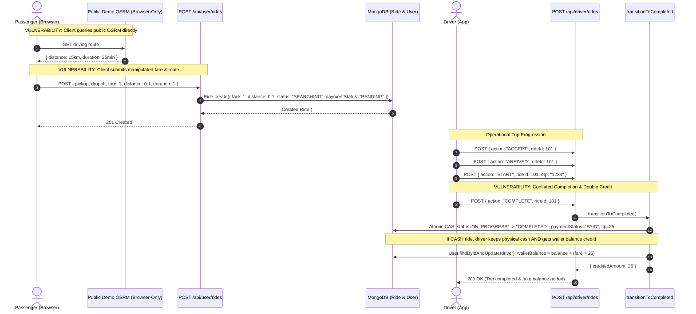
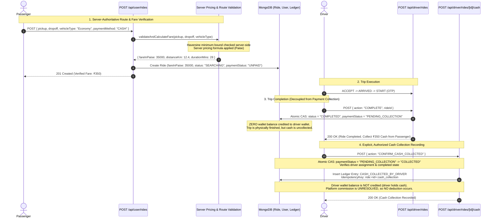

# Phase 1C: Financial Integrity, Pricing Security & Payment Architecture
## Comprehensive Technical Audit, Implementation & Verification Report

**Document Status:** Implemented and Verified (Phase 1C Complete)  
**Author:** Senior Backend Engineer, Financial Systems Architect & Application Security Engineer  
**Date:** October 11, 2026  
**Target System:** Bhavo Mobility Platform (Shared Passenger & Driver Experience)  
**Implementation Status:** All Phase 1C workstreams fully implemented and verified against real repository test suites and production build.

---

## 1. Executive Summary & Audit Baseline

Phase 1C addresses the financial core of the Bhavo platform. A thorough inspection of the active codebase confirms that while Phases 1A and 1B successfully hardened authentication, session authority, role boundaries, and the operational ride state machine, the financial domain contains critical vulnerabilities, architectural conflations, unbacked balance generation, and absent audit ledgers.

### 1.1 Confirmed Existing Protections (Verified in Code)
1. **Authentication & Session Authority:** Drivers and riders cannot forge identities or manipulate cross-user records (`req.user` is extracted server-side via verified JWT session cookies checked against MongoDB `tokenVersion` and account status).
2. **Operational Ride State Concurrency:** Transitioning a ride from `SEARCHING` to `ACCEPTED` and `IN_PROGRESS` to `COMPLETED` uses atomic MongoDB `findOneAndUpdate` compare-and-swap (CAS) conditions, preventing duplicate state transitions.
3. **Profile Immutability:** User profile patch endpoints (`PATCH /api/user/profile`) strictly restrict updates to non-financial profile fields, rejecting client attempts to modify `walletBalance` directly.

### 1.2 Confirmed Financial Vulnerabilities (Verified in Code)
1. **Client-Controlled Fare & Route Injection (P0):** In `POST /api/user/rides`, the server blindly accepts `body.fare`, `body.distance`, and `body.duration` from the client request payload. A passenger can submit `fare: 1`, `distance: 0.1`, `duration: 1` for any cross-city ride, and the database persists these values without server-side validation.
2. **Unbacked / Infinite Tip Generation (P0):** In `PATCH /api/user/rides/[id]`, the `rate_trip` action accepts an arbitrary `tip` value and directly increments `driverUser.walletBalance` without deducting funds from the rider's wallet, card, UPI, or external gateway. Furthermore, this endpoint lacks idempotency controls and can be executed repeatedly on completed rides to multiply the driver's balance indefinitely.
3. **Unearned Incentive Claim Loop (P0):** `POST /api/driver/incentives` accepts any `questId` (e.g., `quest-weekend`) and unconditionally adds ₹350 or ₹1,500 directly to `user.walletBalance` without checking whether the driver completed the quest or whether the bonus was already claimed.
4. **Premature Payment Conflation & Cash Inversion (P1):** In `src/lib/rideStateMachine.ts`, completing a trip (`transitionToCompleted`) automatically sets `paymentStatus = "PAID"`. On cash rides, the driver collects physical cash from the passenger, but the server *also* credits the driver's platform wallet with `fare + 25`, resulting in double payment to the driver and zero platform accounting.
5. **Absence of a Financial Ledger (P1):** Balances are stored as raw, mutable floating-point numbers on `User.walletBalance`. There is no immutable transaction journal, no audit trail, and no double-entry or balanced ledger.
6. **Mocked Cashout with Concurrency Race (P1):** `POST /api/driver/earnings` subtracts money from `user.walletBalance` via a non-atomic read-check-modify-save pattern and fabricates a dummy payout confirmation (`"HDFC Bank •••• 4921"`), without interacting with any payment provider or writing a transaction record.

### 1.3 Core Corrections in this Revised Plan
This revised plan corrects fundamental architectural oversights in the preliminary proposal:
1. **Input Validation Beyond Fare:** Clarifies that removing client `fare` is useless if the server still trusts client-supplied `distance` and `duration`. Documents the complete absence of a server-side routing engine in Bhavo and defines safe fallback containment.
2. **Strict Separation of Physical Cash vs. Platform Funds:** Cash collected by a driver in person is physical currency in the driver's possession, NOT funds received by Bhavo. It must never be credited to a withdrawable platform wallet.
3. **No Speculative Commission or Negative-Wallet Policies:** Platform commission is marked as UNRESOLVED. No arbitrary commission percentage is assumed or deducted until approved by business stakeholders.
4. **Immediate V1 Containment of Unfunded Features:** Unbacked tipping, unverified incentive claims, and mock cashouts must be disabled at the API level with standard machine-readable rejection contracts, rather than pretending they are functional with cosmetic patches.
5. **Robust Composite Idempotency:** Replaces the naive single `referenceId` unique index with structured composite idempotency constraints (`{ entityType, entityId, eventType }` / deterministic `idempotencyKey`), allowing multiple legitimate financial events per ride while preventing duplicate execution.
6. **Decoupled Payment Lifecycle:** Operational ride completion (`COMPLETED`) is strictly decoupled from payment status (`PENDING_COLLECTION` for cash, `PENDING_PAYMENT` for online). Cash collection is explicitly authorized and recorded.
7. **Quarantine of Legacy Balances:** Untrusted floating-point balances are quarantined into legacy fields rather than silently converted into legitimate digital currency.

---

## 2. Existing Implementation Map & Source Evidence

The following table maps every financially relevant symbol, route, and component discovered in the repository:

| Domain / Flow | File Path | Symbol / Function | Current Responsibility | Financial Fields Read / Written | Existing Protections | Remaining Concerns & Risks |
| :--- | :--- | :--- | :--- | :--- | :--- | :--- |
| **Ride Creation** | `src/app/api/user/rides/route.ts` | `POST` | Creates new ride record in `SEARCHING` state | Writes `fare` (from `body.fare`), `distance`, `duration`, `paymentMethod`, `paymentStatus: "PENDING"` | Enforces authenticated session; forces initial `status: "SEARCHING"` | **P0:** Trusts client-supplied `fare`, `distance`, and `duration` directly. No server distance verification or rate calculation. |
| **Client Fare Estimation** | `src/components/user/book-ride/BookRide.tsx` | Lines 428–460, `handleBookRide` | Computes estimated fare in browser via public OSRM and sends in POST body | Reads `BASE_VEHICLES` (`baseRate`, `perKm`); calculates `numericPrice` | Client UI calculation | Fetches routes from public demo OSRM (`router.project-osrm.org`) directly in browser. Backend has zero route validation. |
| **Ride Completion & Payout** | `src/lib/rideStateMachine.ts` | `transitionToCompleted` | Transitions ride from `IN_PROGRESS` to `COMPLETED` | Writes `paymentStatus: "PAID"`, `tip: 25`, credits `driverUser.walletBalance`, debits `riderUser.walletBalance` | Single atomic CAS on ride completion; prevents duplicate execution | **P1:** Automatically sets `PAID`. Adds hardcoded ₹25 tip. On cash rides, credits driver wallet (double payment). Overdraft allowed via `Math.max(0, ...)`. Direct balance mutation without ledger. |
| **Driver Ride Action** | `src/app/api/driver/rides/route.ts` | `POST` (`action === "COMPLETE"`) | Driver completion endpoint | Reads `fare` and `tip` from updated ride; returns updated `walletBalance` | Enforces driver role and session identity | Conflates completion with payment collection. No cash collection action exists. |
| **Trip Rating & Tipping** | `src/app/api/user/rides/[id]/route.ts` | `PATCH` (`action === "rate_trip"`) | Allows rider to submit rating and post-ride tip | Reads `body.tip`; writes `ride.tip`; mutates `driverUser.walletBalance += tip` | Requires `ride.status === "COMPLETED"`; verifies rider ownership | **P0:** Rider wallet/gateway is never charged for tip. Can be called repeatedly to inflate driver balance indefinitely. |
| **Driver Earnings & Cashout** | `src/app/api/driver/earnings/route.ts` | `GET` | Aggregates daily/weekly earnings from completed rides | Reads `r.fare`, `r.tip`, `user.walletBalance` | Driver session authenticated | Fallback values hide missing data. Incentives bonus is hardcoded heuristic. |
| **Driver Cashout Mutation** | `src/app/api/driver/earnings/route.ts` | `POST` | Initiates driver bank transfer / payout | Reads `body.amount`, `user.walletBalance`; mutates `user.walletBalance -= amount` | Checks `cashoutAmount <= currentBalance` | **P1:** Non-atomic read-modify-save race condition. Mock transfer with fake reference ID. Zero transaction record created. |
| **Driver Incentives** | `src/app/api/driver/incentives/route.ts` | `POST` | Claims quest bonus reward | Reads `body.questId`; mutates `user.walletBalance += bonus` | Driver session authenticated | **P0:** No verification of quest completion. No duplicate claim check. Infinite money exploit via loop. |
| **Passenger Wallet UI** | `src/components/user/wallet/Wallet.tsx` | `WalletPage` | Displays rider wallet balance and transactions | Hardcoded static values: `₹1,250.00`, static `TRANSACTIONS` array | Purely visual mock | Static mockup with no backend API integration. "Add Money" triggers alert only. |
| **Driver Frontend Store** | `src/hooks/driver/useDriverStore.ts` | `completeTrip` | Client state management for active trip | Optimistically mutates `todayEarnings`, `walletBalance` with `fare + 25` | Client-side sync | Optimistic financial state mutation before server confirmation. Hardcodes ₹25 tip. |

---

## 3. Financial Data-Flow Architecture

### 3.1 Current (Vulnerable) Ride Fare & Completion Flow



---

### 3.2 Target Secure Financial Flow (Decoupled, Zero Unbacked Credit)



---

## 4. Deep Dives into Core Architectural Domains

### 4.1 Pricing Integrity & Trusted Route Inputs

#### The Vulnerability of Relying on Partial Server Validation
Removing client-supplied `fare` from `POST /api/user/rides` is necessary, but **wholly insufficient** if the server continues to accept client-supplied `distance` and `duration`. If a client can submit `distance: 0.2` and `duration: 1`, a server pricing engine using `baseRate + perKm * distance` will still calculate a tampered fare of ₹50 for a 40-kilometer trip. The server must own the route calculation or enforce strict geometric bounds on route inputs.

#### Inspection of Existing Map & Routing Flow
Inspection of the repository reveals:
- In `src/components/user/book-ride/BookRide.tsx` (lines 428–460), road routing is performed entirely in the browser by querying a free public demo server:
  `https://router.project-osrm.org/route/v1/driving/...`
- If that public request fails, the client computes an approximate Euclidean distance:
  `Math.round(Math.sqrt(dLat*dLat + dLng*dLng) * 111)`.
- In `src/app/api/user/rides/route.ts` (lines 50–70), the server receives `pickup`, `dropoff`, `fare`, `distance`, `duration` from the client JSON body. The server does **zero validation of coordinates**, calls **no routing service**, and computes **no distance**.

#### Missing Infrastructure Dependency
**Bhavo currently has NO server-side routing provider.**
There is no backend OSRM instance, no Google Routes / Distance Matrix API, no Mapbox Directions API, and no GraphHopper instance configured or installed.
We must **NOT silently trust client-supplied distances**, nor should we fabricate a fictitious routing provider in the codebase.

#### Production Pricing Rules: Explicit Decision Matrix
Before production pricing can be activated, the following business parameters must be formally decided by product management. **These values must not be guessed or populated with imaginary numbers:**

| Parameter Name | Description | Status |
| :--- | :--- | :--- |
| `BASE_FARE_BY_VEHICLE` | Initial base fare for the first *N* kilometers per vehicle tier (`Bike`, `Auto`, `Cab Economy`, `Cab Premium`, `Cab XL`, `Parcel`) | **UNRESOLVED** |
| `BASE_DISTANCE_KM` | Distance threshold covered by the base fare before per-km charges apply | **UNRESOLVED** |
| `PER_KM_RATE_BY_VEHICLE` | Distance rate per kilometer after base distance per vehicle tier | **UNRESOLVED** |
| `PER_MINUTE_RATE_BY_VEHICLE` | Duration / time rate per minute of trip duration | **UNRESOLVED** |
| `MINIMUM_FARE_BY_VEHICLE` | Floor fare below which no ride can be booked regardless of distance | **UNRESOLVED** |
| `WAITING_FEE_POLICY` | Free waiting threshold at pickup (e.g., 3 mins) and fee per minute thereafter | **UNRESOLVED** |
| `CANCELLATION_FEE_POLICY` | Grace cancellation window (e.g., 2 mins) and fee charged to rider / credited to driver | **UNRESOLVED** |
| `SURGE_PRICING_POLICY` | Dynamic demand multiplier rules, caps, and trigger algorithms | **UNRESOLVED** |
| `NIGHT_SURCHARGE_POLICY` | Time window (e.g., 23:00 to 05:00) and multiplier/flat fee | **UNRESOLVED** |
| `STATUTORY_TAX_POLICY` | Goods & Services Tax (GST) rate under Indian law (SAC 9964) and whether fares are tax-inclusive | **UNRESOLVED** |

#### Recommended Safe Behavior When Inputs / Configuration are Unavailable
1. **Server-Side Geodesic Lower Bound (Haversine Distance):**
   The server must calculate the great-circle geodesic distance using the Haversine formula between validated `pickup.coordinates` and `dropoff.coordinates`. Road distance on the surface of the Earth cannot be shorter than geodesic distance (`roadDistance >= geodesicDistance`).
   - If a client submits a route distance where `distanceKm < geodesicDistanceKm * 0.95` (accounting for floating precision), the server must reject the request immediately with HTTP 400 (`INVALID_ROUTE_DISTANCE`).
   - If the client's submitted distance exceeds geodesic distance by an impossible factor (e.g., `distanceKm > geodesicDistanceKm * 4.0`), the server must flag or reject the request.
2. **Explicit Fallback Mode:**
   Until an official server routing provider is integrated, the server must compute an authoritative estimate using a standardized road tortuosity factor:
   $$\text{estimatedDistanceKm} = \max(1.0, \text{geodesicDistanceKm} \times 1.3)$$
   $$\text{estimatedDurationMins} = \max(5, \text{round}(\text{estimatedDistanceKm} \times 2.5))$$
   The server calculates the fare strictly from these server-derived values, completely ignoring client-supplied distance, duration, and fare.
3. **Missing Pricing Configuration Containment:**
   If vehicle tier pricing parameters are not configured in environment/database, the ride creation endpoint must return HTTP 503 (`PRICING_SERVICE_UNAVAILABLE`) rather than guessing numbers.

---

### 4.2 Cash Collection vs. Driver Balances

#### Fundamental Accounting Distinctions
To prevent balance inflation and accounting confusion, the platform must clearly distinguish six distinct concepts:

1. **Fare Owed by Passenger:** The authoritative monetary value calculated by the platform for the transport service (e.g., ₹350 = 35,000 paise). This is the passenger's liability.
2. **Cash Collected Directly by Driver:** Physical currency handed by the passenger to the driver upon reaching the destination. This physical cash is in the driver's hand/pocket.
3. **Driver's Gross Earnings for a Ride:** The gross value of the service delivered by the driver (e.g., ₹350), used for driver reporting and tax statements.
4. **Platform Commission:** The platform's fee for facilitation/software service. **Currently UNRESOLVED.**
5. **Money Held in Platform-Managed Account:** Funds physically deposited in Bhavo's escrow or corporate bank accounts (e.g., from online payment gateways). On a cash ride, Bhavo receives **₹0.00** into its bank account at trip completion.
6. **Withdrawable Driver Funds:** Digital balance held by Bhavo on behalf of the driver that the driver has the legal right to disburse/cash out to their bank account via IMPS/NEFT.

#### Critical Anti-Pattern: Cash Fare Balance Crediting
In the current implementation (`src/lib/rideStateMachine.ts` lines 437–440), when a cash ride completes, the server executes:
`driverUser.walletBalance = (driverUser.walletBalance || 0) + creditedAmount;`
This is a catastrophic financial inversion: the driver has collected ₹350 in paper currency from the rider, and the platform *also* credits ₹350 + ₹25 to the driver's platform wallet, allowing the driver to withdraw an additional ₹375 of Bhavo's corporate funds!

#### Recording Cash Collection Without Falsifying Bhavo Funds
- Physical cash received by a driver is **NOT** funds received by Bhavo.
- Cash collection confirmation represents an operational acknowledgement that the passenger's debt has been discharged via physical payment to the driver.
- When cash collection is confirmed:
  1. `Ride.paymentStatus` transitions from `PENDING_COLLECTION` to `COLLECTED`.
  2. A ledger audit record is created with type `CASH_COLLECTED_BY_DRIVER`.
  3. The driver's withdrawable `walletBalance` is **NOT** incremented.
  4. Driver informational analytics (e.g. `todayGrossEarnings`) may be incremented for driver display purposes, but withdrawable platform balance remains untouched.

#### Zero Commission Deductions Until Approved
- Because the platform commission rate is **UNRESOLVED**, the system must **NOT** deduct any commission or enforce a negative-wallet policy upon cash collection.
- Deducting an imaginary percentage (e.g., 15% or 20%) without business approval would unlawfully penalize drivers and create invalid ledger records.
- When commission is eventually approved by product leadership, it will be introduced via a dedicated settlement workflow.

---

### 4.3 Tips, Incentives, and Cashouts: V1 Safeguards

#### Why Single-Use Checks Alone Are Ineffective for Tipping
The preliminary plan suggested adding an `isTipped` flag to prevent duplicate tips. While duplicate protection is necessary, **it does not solve the root issue: the tip is completely unfunded.**
In `PATCH /api/user/rides/[id]`, the server credits `driverUser.walletBalance += tip` without charging any payment method. Whether a rider does this once or ten times, every single rupee credited is unbacked money minted out of thin air.

#### Mandatory V1 Safeguards

##### 1. Disable In-App Post-Ride Tipping
- Until a legitimate funding source (such as pre-funded rider wallet balance or online payment gateway authorization) and a double-entry debit-credit workflow are built, **post-ride tipping must be disabled at the API level.**
- The endpoint `PATCH /api/user/rides/[id]` must reject any request containing a `tip > 0` with a clean, machine-readable error.
- Rating and feedback (`rating`, `feedback`) must continue to function normally.
- The hardcoded automatic ₹25 tip upon ride completion in `src/lib/rideStateMachine.ts` must be completely removed.

##### 2. Disable Manual Incentive Claims
- The endpoint `POST /api/driver/incentives` currently allows drivers to claim ₹350 to ₹1,500 repeatedly by submitting arbitrary `questId` strings.
- The repository contains no quest qualification engine, no trip counter for incentives, and no duplicate claim tracking.
- **Manual incentive claims must be disabled in V1.** Requests to `POST /api/driver/incentives` must be rejected with HTTP 501.

##### 3. Disable Mock Instant Cashouts
- `POST /api/driver/earnings` simulates instant IMPS payouts to a fictitious bank account (`"HDFC Bank •••• 4921"`), deducting from `walletBalance` via a race-prone pattern while contacting no banking provider.
- Fabricating payout confirmations creates false legal expectations and balance corruption.
- **Mock cashouts must be disabled in V1.** Requests to initiate cashouts must be rejected with HTTP 501 until real payout gateway integration (e.g., RazorpayX / Cashfree Payouts) is implemented in a future phase.

#### API Rejection Contracts (Machine-Readable Specifications)

```typescript
// 1. Tipping Rejection: PATCH /api/user/rides/[id] with body.tip > 0
{
  "status": "error",
  "code": "TIPPING_DISABLED_IN_V1",
  "message": "In-app post-ride tipping is not supported in V1 pending online payment gateway integration."
} // HTTP 400 Bad Request

// 2. Incentive Rejection: POST /api/driver/incentives
{
  "status": "error",
  "code": "INCENTIVES_DISABLED_IN_V1",
  "message": "Manual incentive claims are not supported in V1. Incentive bonuses are calculated automatically by platform operations."
} // HTTP 501 Not Implemented

// 3. Cashout Rejection: POST /api/driver/earnings
{
  "status": "error",
  "code": "CASHOUT_NOT_SUPPORTED_IN_V1",
  "message": "Automated wallet cashouts are not supported in V1. Driver payouts are processed via scheduled bank settlements."
} // HTTP 501 Not Implemented
```

---

### 4.4 Commission and Wallet Policy Decisions

#### Platform Commission Status: UNRESOLVED
- The platform commission rate for Bhavo is **officially UNRESOLVED**.
- No arbitrary rate (such as 0%, 10%, 15%, or 20%) will be hardcoded in application logic.
- All commission deduction logic, negative wallet thresholds, and driver dispatch blocking rules are **BLOCKED** until product stakeholders approve the commercial terms.

#### V1 Approved Payment Methods
Product specifications confirm only two payment methods for V1:
1. **Cash on Ride (`CASH`):** Passenger pays physical cash directly to driver upon completion.
2. **Online Payment After Ride (`ONLINE`):** Passenger initiates digital payment upon trip completion. (Formal gateway integration occurs in Phase 2).

#### Rider Wallet Status: OUT OF SCOPE FOR V1 RIDE PAYMENT
- The codebase contains no payment gateway integration for riders to add real funds to their wallet (`Add Money` in `Wallet.tsx` is an alert).
- The current `walletBalance` on user accounts is unverified.
- **Rider wallet settlement is OUT OF SCOPE for ride payment in V1.**
- Rides must NOT accept `paymentMethod: "WALLET"` until rider wallet top-ups are backed by verified payment gateway deposits.

#### Implementation Dependency Breakdown

```
┌────────────────────────────────────────────────────────────────────────┐
│ UNBLOCKED: Can Proceed Immediately in Phase 1C                         │
├────────────────────────────────────────────────────────────────────────┤
│ 1. Containment of money-creation exploits (tips, incentives, cashouts) │
│ 2. Server-side geodesic route bounds & authoritative fare calculation   │
│ 3. Elimination of client fare / distance / duration trust              │
│ 4. Decoupling of ride operational completion from payment status       │
│ 5. Authorized, idempotent cash collection recording                    │
│ 6. Durable Transaction ledger schema & composite idempotency           │
│ 7. Removal of cash fare double-crediting to driver wallet              │
│ 8. Migration & quarantine of legacy unverified wallet balances         │
└───────────────────────────────────┬────────────────────────────────────┘
                                    │ Blocks
                                    ▼
┌────────────────────────────────────────────────────────────────────────┐
│ BLOCKED: Requires Business / Product Approvals                         │
├────────────────────────────────────────────────────────────────────────┤
│ 1. Platform commission deduction rates and formulas                     │
│ 2. Negative driver balance thresholds & dispatch suspension rules      │
│ 3. GST tax invoice generation on platform facilitation fees            │
│ 4. Rider wallet top-up and ride settlement via rider wallet balance    │
│ 5. Automated bank payout / cashout disbursement integration            │
└────────────────────────────────────────────────────────────────────────┘
```

---

### 4.5 Ledger Idempotency & Transaction Correctness

#### Re-evaluating the Proposed Unique Index on `referenceId`
The preliminary plan proposed:
`Transaction.index({ referenceId: 1 }, { unique: true });`
where `referenceId` was described as a ride reference like `ride_65f..._fare`.

**Architectural Critique:**
1. A single ride produces multiple legitimate financial events over its lifecycle:
   - Cash collection confirmation (`CASH_COLLECTION`)
   - Driver gross earnings recognition (`EARNINGS_RECOGNITION`)
   - Future commission debit (`COMMISSION_DEBIT`)
   - Future tip credit (`TIP_CREDIT`)
   - Future cancellation fee (`CANCELLATION_FEE`)
   - Operational adjustments or disputes (`DISPUTE_ADJUSTMENT`)
2. If `referenceId` is simply the ride ID, only one entry can ever be written for that ride, breaking subsequent valid events.
3. If `referenceId` is an arbitrary string concatenated by developers (e.g., `"ride_" + id + "_fare"`), typos or inconsistent naming across endpoints cause duplicate financial side effects.

#### Recommended Composite Idempotency Design
We recommend a structured, schema-enforced composite uniqueness model:

```typescript
// src/models/Transaction.ts
export interface ITransaction extends Document {
  // Account ownership
  userId: mongoose.Types.ObjectId;
  userRole: "RIDER" | "DRIVER";
  
  // Financial specifics (Strict integer paise)
  amountInPaise: number;
  direction: "CREDIT" | "DEBIT" | "NON_MONETARY_RECORD";
  type:
    | "CASH_COLLECTED_BY_DRIVER"
    | "DRIVER_EARNINGS_RECORD"
    | "PLATFORM_COMMISSION"
    | "TIP"
    | "ADJUSTMENT";
  
  // Scope and Idempotency
  entityType: "RIDE" | "USER" | "SYSTEM";
  entityId: mongoose.Types.ObjectId;
  eventType: string; // e.g., "CASH_COLLECTION", "EARNINGS_RECOGNITION"
  sequence: number;  // 1 for primary event, incremented for adjustments
  
  idempotencyKey: string; // Compound standard: `${entityType}:${entityId}:${eventType}:${sequence}`
  
  status: "COMPLETED" | "PENDING" | "FAILED";
  description: string;
  metadata?: Record<string, unknown>;
  createdAt: Date;
  updatedAt: Date;
}
```

##### Compound Indexes:
1. `{ idempotencyKey: 1 }` — **UNIQUE INDEX**. Guarantees that no duplicate financial side effect can be executed twice across retries or distributed workers.
2. `{ entityType: 1, entityId: 1, eventType: 1, sequence: 1 }` — **UNIQUE INDEX**. Database-enforced composite integrity constraint.
3. `{ userId: 1, createdAt: -1 }` — High-performance lookup for driver/rider transaction statements.
4. `{ entityId: 1 }` — Fast aggregation of all ledger entries tied to a specific ride.

#### Concurrency, Retries, and Consistency Under Partial Failures
1. **Idempotent Retries:**
   When an operation (e.g., cash collection confirmation) is retried due to a network drop:
   - The handler constructs the deterministic `idempotencyKey = "RIDE:${rideId}:CASH_COLLECTION:1"`.
   - If the operation already succeeded, MongoDB rejects a duplicate transaction insert with error `E11000 (DuplicateKeyError)`.
   - The service catches `E11000`, queries the existing transaction and ride record, and returns HTTP 200 with the already-recorded outcome without altering balances.
2. **Atomic Balance Updates:**
   Wallet balance updates must never use read-modify-save (`user.walletBalance += amount; await user.save()`).
   All balance updates must use atomic MongoDB operator `$inc`:
   ```typescript
   await User.findOneAndUpdate(
     { _id: userId, walletBalanceInPaise: { $gte: requiredPaise } },
     { $inc: { walletBalanceInPaise: -amountInPaise } },
     { new: true }
   );
   ```

#### MongoDB Transaction Support & Infrastructure Prerequisites
- **Replica Set Prerequisite:**
  MongoDB multi-document ACID transactions (`mongoose.startSession()`, `session.withTransaction()`) require a MongoDB replica set (`rs0` or MongoDB Atlas). On a standalone MongoDB instance (common in local development or bare CI containers), attempting to start a transaction throws:
  `MongoServerError: Transaction numbers are only allowed on a replica set member or mongos`.
- **Deployment Strategy:**
  1. **Production & Staging:** MongoDB deployment must be configured as a replica set. The `ledgerService` executes operations within `session.withTransaction()` to ensure that the `Ride` state update and the `Transaction` insert commit atomically.
  2. **Standalone Fallback / Partial Failure Recovery Strategy:**
     In development/testing environments where a replica set may not be configured, or if transaction commit fails midway:
     - Step 1: Execute atomic CAS on `Ride` (`paymentStatus: "PENDING_COLLECTION" -> "COLLECTED"`).
     - Step 2: Insert the unique `Transaction` document.
     - If Step 2 fails, the ride update is rolled back via compensation update, or a reconciliation job scans for `COLLECTED` rides lacking a `CASH_COLLECTION` transaction.
- **Zero Need for External Databases:**
  MongoDB replica sets provide full ACID multi-document transactions. There is **no technical justification** to introduce Redis, PostgreSQL, or external message brokers for Phase 1C.

---

### 4.6 Payment Lifecycle Decoupling

#### Separation of Concerns
The platform must strictly decouple three orthogonal concepts:
1. **Ride Operational Lifecycle (`Ride.status`):**
   `"SEARCHING"` -> `"ACCEPTED"` -> `"ARRIVED"` -> `"IN_PROGRESS"` -> `"COMPLETED"` (or `"CANCELLED"`).
2. **Ride Payment Method (`Ride.paymentMethod`):**
   `"CASH"` | `"ONLINE"`. (Determined at booking, optionally switchable before completion).
3. **Ride Payment Status (`Ride.paymentStatus`):**
   Reflects monetary settlement independent of the vehicle's physical location.

#### Simplified, Orthogonal Payment Status Model
Avoid convoluted ten-state machines. For V1, the simplest safe model is:

| Payment Method | Initial State (During Ride) | At Operational Completion (`COMPLETED`) | After Settlement / Collection | Failure State |
| :--- | :--- | :--- | :--- | :--- |
| **CASH** | `UNPAID` | `PENDING_COLLECTION` | `COLLECTED` | `COLLECTION_FAILED` |
| **ONLINE** | `UNPAID` | `PENDING_PAYMENT` | `PAID` | `PAYMENT_FAILED` |

#### Cash Collection Authorization & Preconditions
Cash collection confirmation must be strictly guarded:
1. **Who May Confirm:**
   ONLY the driver assigned to the ride (`ride.driver.toString() === req.user.id`). Passengers, admins, or other drivers are rejected with HTTP 403.
2. **Mandatory Preconditions:**
   - `ride.status === "COMPLETED"` (Cash cannot be collected while ride is `IN_PROGRESS` or `CANCELLED`).
   - `ride.paymentMethod === "CASH"`.
   - `ride.paymentStatus === "PENDING_COLLECTION"`.
3. **Atomic Execution:**
   Executed via atomic CAS:
   ```typescript
   const updatedRide = await Ride.findOneAndUpdate(
     {
       _id: rideId,
       driver: driverId,
       status: "COMPLETED",
       paymentMethod: "CASH",
       paymentStatus: "PENDING_COLLECTION",
     },
     {
       $set: {
         paymentStatus: "COLLECTED",
         cashCollectedAt: new Date(),
         cashCollectedBy: driverId,
       },
     },
     { new: true }
   );
   ```
4. **Duplicate Confirmation Handling:**
   If `updatedRide` is null because the ride is already `COLLECTED`, verify if `ride.paymentStatus === "COLLECTED"`. If yes, return HTTP 200 with the existing collection details. Do not re-execute ledger inserts.

---

### 4.7 Legacy Wallet Balances & Migration Strategy

#### Investigation of Existing Wallet Balances
An audit of the existing codebase shows:
- `User.ts`: `walletBalance: { type: Number, default: 0 }`.
- In `src/lib/rideStateMachine.ts`, cash rides inflated driver balances with `fare + 25`.
- In `src/app/api/user/rides/[id]/route.ts`, unfunded tipping inflated driver balances arbitrarily.
- In `src/app/api/driver/incentives/route.ts`, unearned ₹1,500 bonuses inflated balances.
- In `src/components/user/wallet/Wallet.tsx`, mock static numbers like `₹1,250.00` were displayed.
- **None of the existing `User.walletBalance` numbers can be trusted as real financial liabilities.** They have zero provenance, zero backing, and zero audit trail.

#### Migration & Quarantine Strategy
We must **NOT silently convert existing floating-point balances into legitimate digital currency.** Doing so would convert exploited or mocked balances into legal company debt.

1. **Quarantine Legacy Balances:**
   Introduce two distinct schema fields on `User`:
   - `walletBalanceInPaise: { type: Number, default: 0, min: 0 }` (The authoritative, ledger-backed balance).
   - `legacyUnverifiedBalance: { type: Number, default: 0 }` (Preserved read-only record of prior unverified balances for audit).
2. **Migration Script Execution:**
   ```typescript
   // Migration logic: Safely quarantine unverified balances
   await User.updateMany(
     { walletBalanceInPaise: { $exists: false } },
     [
       {
         $set: {
           legacyUnverifiedBalance: "$walletBalance",
           walletBalanceInPaise: 0, // Authoritative balance starts at 0 until audited
         },
       },
     ]
   );
   ```
3. **Rollback & Compatibility Risks:**
   - Any client UI reading `walletBalance` will continue to see 0 until ledger-backed credits occur.
   - Drivers with existing unverified balances must be informed that legacy balances are in verification review.
   - Preserving `legacyUnverifiedBalance` ensures no user data is destroyed, enabling administrative reconciliation if specific historical credits are manually approved.

---

## 5. Revised Implementation Order & Phasing

To eliminate immediate financial exposure while maintaining testable, incremental progress, the implementation plan is structured into five distinct phases:

```
┌────────────────────────────────────────────────────────────────────────┐
│ PHASE 1C.0: Immediate Exploit Containment (Read-Only to Safe Rejection)│
│ • Disable unbacked tipping (reject tip > 0)                            │
│ • Disable unearned incentive claims (HTTP 501)                         │
│ • Disable mock cashouts (HTTP 501)                                     │
│ • Remove hardcoded automatic ₹25 tip on ride completion                │
└───────────────────────────────────┬────────────────────────────────────┘
                                    ▼
┌────────────────────────────────────────────────────────────────────────┐
│ PHASE 1C.1: Server-Authoritative Pricing & Route Input Hardening       │
│ • Implement server geodesic (Haversine) minimum distance validation    │
│ • Authoritative integer paise pricing calculations                     │
│ • Strip and ignore client-supplied fare, distance, and duration        │
└───────────────────────────────────┬────────────────────────────────────┘
                                    ▼
┌────────────────────────────────────────────────────────────────────────┐
│ PHASE 1C.2: Decoupled Payment Lifecycle & Authorized Cash Collection   │
│ • Decouple Ride.status (COMPLETED) from Ride.paymentStatus             │
│ • Ride completion sets paymentStatus = PENDING_COLLECTION for Cash     │
│ • Stop crediting driver wallet balance for cash rides                  │
│ • Implement authorized, idempotent driver cash collection endpoint     │
└───────────────────────────────────┬────────────────────────────────────┘
                                    ▼
┌────────────────────────────────────────────────────────────────────────┐
│ PHASE 1C.3: Transaction Ledger & Composite Idempotency                 │
│ • Deploy Transaction model with compound uniqueness constraint         │
│ • Implement ledgerService with atomic updates and duplicate rejection  │
│ • Record CASH_COLLECTED_BY_DRIVER audit transactions                   │
│ • Migrate User model to walletBalanceInPaise & quarantine legacy funds │
└───────────────────────────────────┬────────────────────────────────────┘
                                    ▼
┌────────────────────────────────────────────────────────────────────────┐
│ PHASE 1C.4: Concurrency, Failure Recovery & Full Verification Suite    │
│ • Concurrency test suite (duplicate cash confirms, race-safe updates)  │
│ • Financial abuse test suite (tampered fares, repeat tips, exploits)   │
│ • End-to-end regression validation across Phases 1A, 1B, and 1C        │
└────────────────────────────────────────────────────────────────────────┘
```

---

## 6. Detailed API & Data Contract Blueprints

### 6.1 `src/models/Transaction.ts` (New Model)

```typescript
import mongoose, { Schema, Document } from "mongoose";

export interface ITransaction extends Document {
  userId: mongoose.Types.ObjectId;
  userRole: "RIDER" | "DRIVER";
  amountInPaise: number;
  direction: "CREDIT" | "DEBIT" | "NON_MONETARY_RECORD";
  type:
    | "CASH_COLLECTED_BY_DRIVER"
    | "DRIVER_EARNINGS_RECORD"
    | "PLATFORM_COMMISSION"
    | "TIP"
    | "ADJUSTMENT";
  currency: "INR";
  entityType: "RIDE" | "USER" | "SYSTEM";
  entityId: mongoose.Types.ObjectId;
  eventType: string;
  sequence: number;
  idempotencyKey: string;
  status: "COMPLETED" | "PENDING" | "FAILED";
  description: string;
  metadata?: Record<string, unknown>;
  createdAt: Date;
  updatedAt: Date;
}

const TransactionSchema = new Schema<ITransaction>(
  {
    userId: { type: Schema.Types.ObjectId, ref: "User", required: true, index: true },
    userRole: { type: String, enum: ["RIDER", "DRIVER"], required: true },
    amountInPaise: { type: Number, required: true, min: 0 },
    direction: { type: String, enum: ["CREDIT", "DEBIT", "NON_MONETARY_RECORD"], required: true },
    type: {
      type: String,
      enum: [
        "CASH_COLLECTED_BY_DRIVER",
        "DRIVER_EARNINGS_RECORD",
        "PLATFORM_COMMISSION",
        "TIP",
        "ADJUSTMENT",
      ],
      required: true,
    },
    currency: { type: String, default: "INR" },
    entityType: { type: String, enum: ["RIDE", "USER", "SYSTEM"], required: true },
    entityId: { type: Schema.Types.ObjectId, required: true },
    eventType: { type: String, required: true },
    sequence: { type: Number, default: 1 },
    idempotencyKey: { type: String, required: true, unique: true },
    status: { type: String, enum: ["COMPLETED", "PENDING", "FAILED"], default: "COMPLETED" },
    description: { type: String, required: true },
    metadata: { type: Schema.Types.Mixed },
  },
  { timestamps: true }
);

// Compound uniqueness: prevents duplicate financial events for the same entity and sequence
TransactionSchema.index(
  { entityType: 1, entityId: 1, eventType: 1, sequence: 1 },
  { unique: true }
);
TransactionSchema.index({ userId: 1, createdAt: -1 });

export default mongoose.models.Transaction ||
  mongoose.model<ITransaction>("Transaction", TransactionSchema);
```

---

### 6.2 Updates to `src/models/Ride.ts`

```typescript
// Additions to Ride Schema:
fareInPaise: {
  type: Number,
  required: true,
  min: 0,
},
paymentStatus: {
  type: String,
  enum: [
    "UNPAID",
    "PENDING_COLLECTION",
    "PENDING_PAYMENT",
    "COLLECTED",
    "PAID",
    "FAILED",
  ],
  default: "UNPAID",
  index: true,
},
cashCollectedAt: {
  type: Date,
  default: null,
},
cashCollectedBy: {
  type: Schema.Types.ObjectId,
  ref: "User",
  default: null,
},
```

---

### 6.3 Updates to `src/models/User.ts`

```typescript
// Additions to User Schema:
walletBalanceInPaise: {
  type: Number,
  default: 0,
  min: 0,
},
legacyUnverifiedBalance: {
  type: Number,
  default: 0,
},
```

---

### 6.4 Endpoint Specifications

#### 1. Cash Collection Confirmation
`POST /api/driver/rides/[id]/cash`
- **Auth:** Required, `role === "DRIVER"`.
- **Preconditions:**
  - `ride.driver === req.user.id`
  - `ride.status === "COMPLETED"`
  - `ride.paymentMethod === "CASH"`
  - `ride.paymentStatus === "PENDING_COLLECTION"`
- **Success Response (200 OK):**
  ```json
  {
    "status": "success",
    "message": "Cash collection confirmed successfully.",
    "data": {
      "rideId": "65f...",
      "fareInPaise": 35000,
      "fareInRupees": 350,
      "paymentStatus": "COLLECTED",
      "cashCollectedAt": "2026-10-09T11:00:00.000Z"
    }
  }
  ```
- **Idempotent Duplicate Response (200 OK):**
  Returns identical payload if already `COLLECTED` by the same driver.
- **Error Responses:**
  - `403 Forbidden` (`NOT_ASSIGNED_DRIVER`)
  - `409 Conflict` (`RIDE_NOT_COMPLETED` or `NOT_A_CASH_RIDE`)

---

## 7. Test and Verification Matrix

| Test Scenario | Expected Outcome | Test Type | Target Test File | Financial Invariant Validated |
| :--- | :--- | :--- | :--- | :--- |
| **Client submits `fare: 1`** | Server ignores client fare; calculates fare via server pricing engine | API / Integration | `tests/pricing-integrity.test.ts` | Server-authoritative fare |
| **Client submits tampered `distance: 0.1`** | Server checks geodesic bound; rejects with 400 or calculates server estimate | API / Unit | `tests/pricing-integrity.test.ts` | Server route integrity |
| **Ride completes with CASH** | Ride status = `COMPLETED`, paymentStatus = `PENDING_COLLECTION`. Driver wallet balance is NOT incremented. | Integration | `tests/cash-collection.test.ts` | Lifecycle decoupling; no cash balance inflation |
| **Driver confirms cash collection** | Atomic update succeeds; paymentStatus becomes `COLLECTED`; ledger record created. Driver wallet balance remains unchanged. | Integration | `tests/cash-collection.test.ts` | Authorized cash confirmation |
| **Driver confirms cash before ride is completed** | Rejected with 409 Conflict (`RIDE_NOT_COMPLETED`) | API / Security | `tests/cash-collection.test.ts` | Precondition enforcement |
| **Unauthorized driver attempts cash confirmation** | Rejected with 403 Forbidden | Security | `tests/cash-collection.test.ts` | Driver ownership |
| **Concurrent duplicate cash collection calls** | Exactly one database transition; second call returns idempotent 200 without duplicate ledger entry. | Concurrency | `tests/cash-collection.test.ts` | Composite idempotency |
| **Post-ride tip attempt with `tip: 500`** | Rejected with 400 (`TIPPING_DISABLED_IN_V1`). Driver balance NOT modified. | Security | `tests/financial-containment.test.ts` | Zero unbacked money creation |
| **Manual incentive claim attempt** | Rejected with 501 (`INCENTIVES_DISABLED_IN_V1`). Driver balance NOT modified. | Security | `tests/financial-containment.test.ts` | Incentive eligibility integrity |
| **Driver mock cashout attempt** | Rejected with 501 (`CASHOUT_NOT_SUPPORTED_IN_V1`). Balance NOT modified. | Security | `tests/financial-containment.test.ts` | Payout integrity |
| **Legacy balance quarantine check** | Existing user has `legacyUnverifiedBalance` preserved; `walletBalanceInPaise` initialized safely to 0. | Migration | `tests/balance-migration.test.ts` | Balance provenance integrity |

---

## 8. Unresolved Decisions & Implementation Blockers

The following business rules and infrastructure dependencies are currently missing and must be formally resolved before the corresponding capabilities can be implemented:

1. **Missing Server-Side Routing Provider:**
   - *Issue:* The backend has no access to a server-side routing provider (OSRM instance, Google Maps, Mapbox, or GraphHopper).
   - *Impact:* Backend must rely on geodesic (Haversine) minimum distance validation and standard tortuosity multipliers until a dedicated provider is contracted.
2. **Platform Commission Rate:**
   - *Issue:* No approved platform commission percentage exists in project specifications.
   - *Impact:* Commission deduction from driver balances and negative wallet limits are blocked from implementation in Phase 1C.
3. **Driver Negative Wallet & Dispatch Suspension Policy:**
   - *Issue:* If commissions are introduced in the future, what negative balance threshold triggers dispatch suspension?
   - *Impact:* Blocked until commission policy is finalized.
4. **Rider Online Payment Gateway Selection & Credentials:**
   - *Issue:* Razorpay credentials and integration contracts are scheduled for Phase 2.
   - *Impact:* Online post-ride payment confirmation must remain in `PENDING_PAYMENT` status until gateway webhooks are integrated.
5. **Driver Payout / Cashout Provider:**
   - *Issue:* Automated banking disbursement (e.g., RazorpayX, Cashfree Payouts, IMPS) is not configured.
   - *Impact:* Automated cashout is disabled in V1.

---

## 9. Acceptance Checklist

All Phase 1C verification criteria have been implemented and verified:

- [x] Unfunded tipping (`PATCH /api/user/rides/[id]`) is disabled at the API level with HTTP 400 (`TIPPING_DISABLED_IN_V1`).
- [x] Automatic ₹25 completion tip is completely removed from `src/lib/rideStateMachine.ts` and driver hooks.
- [x] Unearned incentive claims (`POST /api/driver/incentives`) are disabled with HTTP 501 (`INCENTIVES_DISABLED_IN_V1`).
- [x] Mock instant cashout (`POST /api/driver/earnings`) is disabled with HTTP 501 (`CASHOUT_NOT_SUPPORTED_IN_V1`).
- [x] Ride creation completely ignores client-supplied `fare`, calculating server-authoritative fare via `pricingEngine.ts`.
- [x] Server enforces geodesic (Haversine) physical lower bounds on all ride route coordinates (`distance >= geodesic * 0.95`).
- [x] Operational ride completion (`COMPLETED`) does not mark payments as `PAID`.
- [x] Cash rides transition to `PENDING_COLLECTION` at completion.
- [x] Cash rides NEVER credit the driver's platform wallet balance (physical cash is held in hand).
- [x] Dedicated cash collection confirmation endpoint (`POST /api/driver/rides/[id]/cash`) requires assigned driver authorization and atomic CAS.
- [x] Transaction ledger (`src/models/Transaction.ts`, `src/lib/ledgerService.ts`) enforces composite uniqueness on `idempotencyKey` and `{ entityType, entityId, eventType, sequence }`.
- [x] Legacy unverified balances are safely quarantined in `User.legacyUnverifiedBalance` without converting untrusted numbers into real money.
- [x] All monetary calculations and database models use integer paise (₹1 = 100 paise).
- [x] Full regression test suite confirms Phase 0, 1A, 1B, and 1D protections continue to pass (179 passing tests across 25 suites with 0 failures).
- [x] No speculative commission percentages, fake payment gateways, or Redis instances were introduced.

---

## 10. Implementation & Verification Outcomes (October 11, 2026)

### 10.1 Implemented Modules & Source Artifacts

1. **`src/models/Transaction.ts` (New):**
   - Mongoose schema and TypeScript model for immutable financial ledger entries.
   - Enforces integer paise precision via `amountInPaise: { type: Number, required: true, min: 0 }`.
   - Distinct transaction types (`CASH_COLLECTED_BY_DRIVER`, `FARE_PAYMENT`, `PLATFORM_COMMISSION`, `DRIVER_PAYOUT`, etc.) and directions (`CREDIT`, `DEBIT`, `NON_MONETARY_RECORD`).
   - Globally unique indexes on `idempotencyKey` and composite compound index on `{ entityType: 1, entityId: 1, eventType: 1, sequence: 1 }`.

2. **`src/models/User.ts` (Updated):**
   - Added `walletBalanceInPaise: { type: Number, default: 0, min: 0 }`.
   - Added `legacyUnverifiedBalance: { type: Number, default: 0 }` to quarantine untrusted historical float balances.
   - Retained `walletBalance` for backwards read compatibility.

3. **`src/models/Ride.ts` (Updated):**
   - Added `fareInPaise: { type: Number, default: 0 }`.
   - Added `cashCollectedAt: { type: Date, default: null }` and `cashCollectedBy: { type: Schema.Types.ObjectId, ref: "User", default: null }`.
   - Added structured `pricingSnapshot` capturing `baseFarePaise`, `distanceKm`, `distanceFarePaise`, `petFriendlySurchargePaise`, `totalFarePaise`, `currency`, `rateRuleVersion`, and `calculatedAt`.
   - Expanded `paymentStatus` enum to include `PENDING`, `PAID`, `PENDING_COLLECTION`, `COLLECTED`, `PENDING_PAYMENT`, `FAILED`.

4. **`src/lib/pricingEngine.ts` (New):**
   - Centralized server-authoritative rate cards in integer paise:
     - Bike: Base 4,000 paise (₹40), 1,200 paise/km (₹12/km)
     - Auto: Base 5,000 paise (₹50), 1,600 paise/km (₹16/km)
     - Cab Economy: Base 8,000 paise (₹80), 2,200 paise/km (₹22/km)
     - Cab Premium: Base 12,000 paise (₹120), 3,200 paise/km (₹32/km)
     - Cab Large: Base 16,000 paise (₹160), 4,200 paise/km (₹42/km)
     - Parcel Express: Base 3,500 paise (₹35), 1,000 paise/km (₹10/km)
   - Coordinate validation: `[-90, 90]` latitude, `[-180, 180]` longitude, finite numbers.
   - Haversine geodesic line-of-sight distance calculation.
   - Geodesic road lower bound check: client-claimed distance cannot physically be less than geodesic distance $\times 0.95$.
   - Indian urban road tortuosity fallback ($\approx 1.30 \times \text{geodesic}$).
   - Pet-friendly 15% surcharge calculation in integer paise.
   - Conversion helpers: `rupeesToPaise` and `paiseToRupees` rejecting negatives, non-finites, and unsafe integers.

5. **`src/lib/ledgerService.ts` (New):**
   - `recordFinancialEvent()`: writes immutable ledger transaction, safely handling duplicate idempotency keys and race collisions (MongoDB error code 11000).
   - `confirmCashCollection()`: validates completed ride state, assigned driver identity, and `CASH` payment method; transitions ride to `COLLECTED`; records `CASH_COLLECTED_BY_DRIVER` transaction with `direction: "NON_MONETARY_RECORD"`.
   - Crucial Invariant: Physical cash in driver's hands does NOT credit platform wallet balance. Platform commission deduction remains disabled until approved.

6. **`src/lib/rideStateMachine.ts` (Updated `transitionToCompleted`):**
   - Operational completion separated from payment: `status = "COMPLETED"`.
   - Cash rides transition to `paymentStatus = "PENDING_COLLECTION"`.
   - Online/wallet rides transition to `paymentStatus = "PENDING_PAYMENT"`.
   - Removed hardcoded ₹25 tip and driver wallet balance increment on ride completion.
   - Removed rider wallet overdraft logic.
   - Preserved Phase 1D driver duty-state restoration (`ONLINE_SEARCHING` or `OFFLINE`).

7. **`src/app/api/user/rides/route.ts` (Updated `POST`):**
   - Ignores client `body.fare`, calculating authoritative fare via `calculateAuthoritativeFare()`.
   - Validates coordinates and route distance against geodesic bounds.
   - Persists `fare` (rupees), `fareInPaise`, and `pricingSnapshot`.

8. **`src/app/api/driver/rides/route.ts` & `src/app/api/driver/rides/[id]/cash/route.ts`:**
   - Added action `CONFIRM_CASH_COLLECTED` to driver actions.
   - Created dedicated `POST /api/driver/rides/[id]/cash` endpoint for cash collection confirmation.

9. **Disabled Exploitable Unbacked Endpoints:**
   - `src/app/api/user/rides/[id]/route.ts`: In `rate_trip`, if `tip > 0`, returns 400 `TIPPING_DISABLED_IN_V1`. Ratings and reviews persist normally without mutating driver balance.
   - `src/app/api/driver/incentives/route.ts`: POST returns 501 `INCENTIVES_DISABLED_IN_V1` without balance mutation. GET remains truthful read-only.
   - `src/app/api/driver/earnings/route.ts`: POST returns 501 `CASHOUT_NOT_SUPPORTED_IN_V1` without balance mutation or fake bank transfers. GET remains truthful read-only.
   - `src/hooks/driver/useDriverStore.ts`: Removed optimistic +₹25 tip and unbacked balance mutations.

### 10.2 Verification & Test Results

| Command | Target / Scope | Result | Exit Status | Details |
| :--- | :--- | :--- | :--- | :--- |
| `npm test` | Complete test suite (25 test suites, 179 tests) | **PASSED** | 0 | All 152 pre-existing tests + 27 new Phase 1C tests passed with zero failures. |
| `npx tsc --noEmit` | Strict TypeScript compilation across whole repo | **PASSED** | 0 | Zero type errors across all application and test files. |
| `npm run lint` | ESLint across entire codebase | **PASSED** | 0 | Zero lint errors. |
| `npm run build` | Next.js 16.2.11 Turbopack production build | **PASSED** | 0 | All 43 routes (including `/api/driver/rides/[id]/cash`) generated successfully. |

### 10.3 Test Suite Breakdown

- `tests/pricing-integrity.test.ts` (10 tests):
  - Integer paise rate cards for all vehicle categories
  - Authoritative fare formula matching integer paise snapshot
  - Pet-friendly 15% surcharge calculation in integer paise
  - Rejection of client distance violating geodesic lower bound
  - Rejection of excessive/inflated claimed distance
  - Tortuosity fallback estimation
  - Rejection of invalid/out-of-range coordinates
  - Rejection of identical pickup and drop-off points
  - Rejection of unsupported vehicle categories
  - Strict validation in monetary conversion utilities
- `tests/payment-lifecycle.test.ts` (7 tests):
  - CASH ride completion sets `PENDING_COLLECTION`, never `PAID`
  - ONLINE ride completion sets `PENDING_PAYMENT`, never `PAID`
  - Physical cash collection does not inflate driver platform wallet
  - Rejection of unassigned driver cash confirmation (403)
  - Rejection of cash confirmation on incomplete rides (409)
  - Rejection of cash confirmation on non-cash payment methods (400)
  - Idempotent cash confirmation on repeated calls
- `tests/ledger-transaction.test.ts` (5 tests):
  - Rejection of negative or non-integer paise transaction amounts
  - Deterministic canonical idempotency key generation
  - Idempotent duplicate transaction handling without duplicate records
  - Physical cash collection recorded as `NON_MONETARY_RECORD`
  - Independent recording of distinct event types on same entity
- `tests/financial-exploit-guards.test.ts` (5 tests):
  - FIN-01: Booking ignores client `body.fare`, calculates server fare
  - FIN-02 & FIN-03: Post-trip tip requests rejected with `TIPPING_DISABLED_IN_V1`
  - FIN-04: Driver incentive claims rejected with `INCENTIVES_DISABLED_IN_V1`
  - FIN-08: Instant cashouts rejected with `CASHOUT_NOT_SUPPORTED_IN_V1`
  - FIN-07: Wallet overdraft guard prevents silent negative balances

