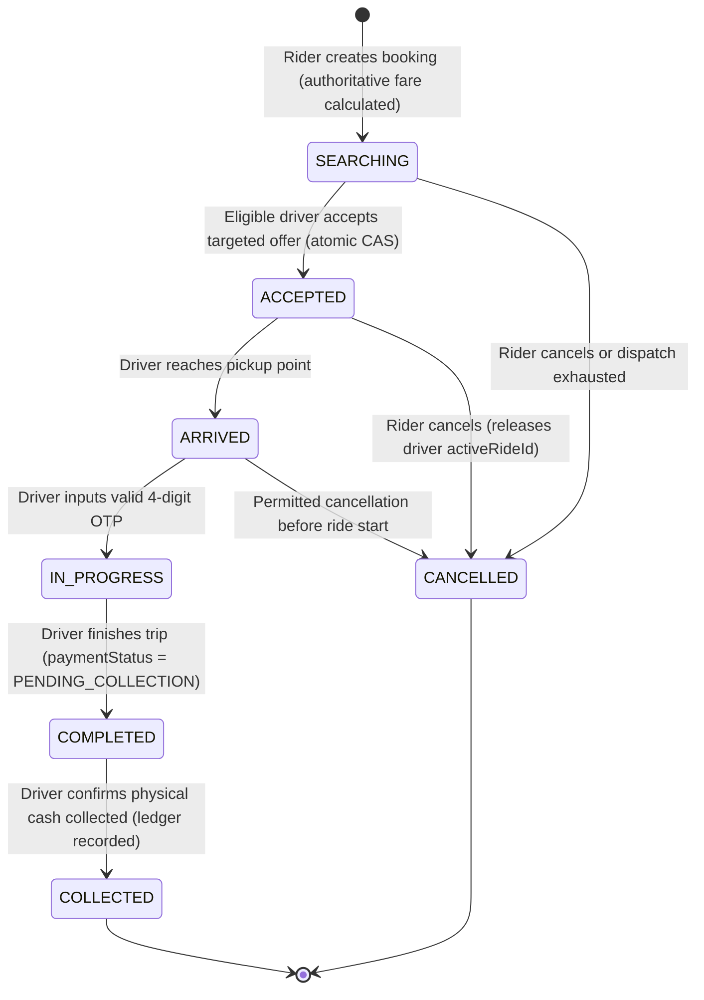

# Bhavo Phase 2: Controlled Launch, Deployment Verification & Real-World Validation
**Milestone:** Phase 2 Master Operational Readiness & Controlled Pilot Verification  
**Status:** **CONDITIONAL GO FOR CONTROLLED PILOT**  
**Version:** 2.0.0  
**Verification Date:** October 12, 2026  
**Execution Environment:** Node.js 20 LTS | Next.js 16.2.11 (Turbopack App Router) | MongoDB / Mongoose 9.9.3 | TypeScript 5.x

---

## 1. Executive Summary & Launch Decision

Bhavo has achieved verified implementation readiness across all core functional domains required for a **restricted, cash-only pilot launch** with real riders and drivers in a designated operating corridor (Pune urban zone).

All repository-level automated gates have passed without exception:
- **Full Test Suite:** **303 / 303 tests passed** across 62 suites (including 32 dedicated Phase 2 staging smoke and end-to-end journey tests).
- **TypeScript Type Checking:** **0 errors** (`npx tsc --noEmit`).
- **Static Code Analysis:** **0 errors, 0 warnings** (`npm run lint`).
- **Production Next.js Turbopack Build:** **49 / 49 routes generated successfully** (`npm run build`).
- **Mutual Exclusion & Concurrency:** Driver exclusivity (`activeRideId`), atomic single-winner ride assignment, and conditional release verified.
- **Financial Ledger & Payment Safety:** Live payment gateways remain strictly disabled (`isLivePaymentEnabled() === false`); physical cash collected by drivers is recorded as immutable `NON_MONETARY_RECORD` and does not inflate platform wallet balances.

### Launch Recommendation: CONDITIONAL GO
The application code, security policies, state machine invariants, background schedulers, and admin operations are verified and ready for deployment. The pilot may commence **only after** an operator fulfills the explicit external hosting prerequisites detailed in Section 10 (database connection string, production secrets, scheduler activation, and MongoDB backup configuration).

---

## 2. Deployment Target Architecture & Runtime Manifest

### 2.1 Target Platform Configuration
Bhavo is structured as a portable Next.js 16 App Router application supporting two primary deployment topologies:

1. **Vercel Serverless Architecture (Primary Recommended Target):**
   - Native support for Next.js 16 App Router, edge route acceleration, and automatic TLS termination.
   - **Source-Controlled Cron Manifest:** Added [`vercel.json`](file:///c:/Users/bhave/Bhavo/my-bhavo/vercel.json) to declare scheduled background processing jobs:
     ```json
     {
       "$schema": "https://openapi.vercel.sh/vercel.json",
       "crons": [
         {
           "path": "/api/cron/auto-booking",
           "schedule": "*/2 * * * *"
         },
         {
           "path": "/api/driver/dispatches/maintenance",
           "schedule": "* * * * *"
         }
       ]
     }
     ```
   - Automated invocation utilizes `CRON_SECRET` configured in Vercel project environment variables.

2. **Persistent Container / Node.js Host (Alternative On-Prem / VM Target):**
   - Production execution command: `npm start` (spawns `next start` on port 3000).
   - Reverse proxy requirements: Nginx / Cloudflare terminating TLS with `X-Forwarded-For`, `X-Forwarded-Proto`, and `Host` headers preserved.
   - Schedulers invoked via systemd timer, Linux cron (`cronie`), or Cloud Scheduler triggering authenticated HTTP requests.

### 2.2 Security Headers & Runtime Hardening
Enforced via [`next.config.ts`](file:///c:/Users/bhave/Bhavo/my-bhavo/next.config.ts):
- `X-Frame-Options: DENY` (Anti-clickjacking).
- `X-Content-Type-Options: nosniff` (MIME sniffing prevention).
- `Referrer-Policy: strict-origin-when-cross-origin`.
- `Permissions-Policy: camera=(), microphone=(), geolocation=(self)`.
- `Strict-Transport-Security: max-age=31536000; includeSubDomains; preload` (enforced when `NODE_ENV === "production"`).

---

## 3. Database Readiness & Index Deployment

### 3.1 Index Deployment Command
Index deployment is decoupled from application serving to guarantee deterministic migration and eliminate runtime cold-start contention:
```bash
npm run db:indexes
# or directly: npx tsx scripts/deployIndexes.ts
```

### 3.2 Collection Indexes Verified
The standalone script [`scripts/deployIndexes.ts`](file:///c:/Users/bhave/Bhavo/my-bhavo/scripts/deployIndexes.ts) invokes [`src/lib/ensureIndexes.ts`](file:///c:/Users/bhave/Bhavo/my-bhavo/src/lib/ensureIndexes.ts) across all 7 Mongoose models:
- **`User`:** Unique index on `email`, unique sparse index on `phone`, compound query index on `{ role: 1, isOnline: 1, dutyState: 1 }`, driver active trip index on `{ activeRideId: 1 }`.
- **`Ride`:** Compound indexes on `{ status: 1, driver: 1, scheduledFor: 1 }`, `{ rider: 1, status: 1 }`, `{ "currentOffer.driverId": 1, "currentOffer.expiresAt": 1 }`, unique sparse index on `{ autoBookingOccurrenceKey: 1 }`.
- **`Transaction`:** Unique index on `{ idempotencyKey: 1 }`, compound unique index on `{ entityType: 1, entityId: 1, eventType: 1, sequence: 1 }`, query index on `{ userId: 1, createdAt: -1 }`.
- **`AutoBookingOccurrence`:** Unique index on `{ occurrenceKey: 1 }`, recovery index on `{ status: 1, lockedUntil: 1 }`.
- **`AdminAuditLog`:** Audit query index on `{ targetType: 1, targetId: 1, createdAt: -1 }`, operator index on `{ actorId: 1, createdAt: -1 }`.
- **`Ticket`:** Compound index on `{ userId: 1, status: 1, createdAt: -1 }`.
- **`Commute`:** Recurrence query index on `{ isActive: 1, status: 1 }`.

### 3.3 Safe Execution Conditions
- Requires MongoDB user credentials with `createIndex` privileges.
- Safe to re-run idempotently; never drops collections or modifies existing records.
- Masks connection strings during CLI execution (credentials never logged).

---

## 4. Tested End-to-End Ride Lifecycle & State Invariants

The complete lifecycle was validated via [`tests/e2e-ride-journey.test.ts`](file:///c:/Users/bhave/Bhavo/my-bhavo/tests/e2e-ride-journey.test.ts):



### 4.1 Invariants Enforced & Tested
1. **Authoritative Fare Pricing:** Client-provided `fare`, `totalFarePaise`, or `status` in request bodies are stripped and replaced with server truth computed by [`src/lib/pricingEngine.ts`](file:///c:/Users/bhave/Bhavo/my-bhavo/src/lib/pricingEngine.ts).
2. **Targeted Driver Eligibility:** Candidate drivers must satisfy 10 binary gates (Role `DRIVER`, status `ACTIVE`, online, `dutyState` available, 100% verified documents, vehicle compatibility, pet compatibility, fresh coordinates < 120s, within radius < 10km, not in `rejectedDrivers`).
3. **Atomic Assignment & Mutual Exclusion:** Concurrent acceptance requests racing for the same ride execute MongoDB compare-and-swap (CAS). Exactly one driver wins; all competing drivers receive `409 Conflict`.
4. **Driver Exclusivity (`activeRideId`):** Drivers holding an active trip cannot accept, discover, or be assigned a second ride. Attempted reservation throws `409 DRIVER_OCCUPIED`.
5. **Mandatory OTP Verification:** The ride cannot transition `ARRIVED` -> `IN_PROGRESS` without the exact 4-digit server-generated OTP. Invalid OTP code returns `400 INVALID_OTP`.
6. **Payment Status Safety on Completion:** Finishing a ride sets `paymentStatus: "PENDING_COLLECTION"`. The ride is **never** automatically marked `PAID`.
7. **Cash Collection & Non-Monetary Ledger:** Driver physical cash confirmation updates `paymentStatus: "COLLECTED"`, sets `cashCollectedAt`, releases driver `activeRideId`, and records an immutable `NON_MONETARY_RECORD` transaction in [`Transaction`](file:///c:/Users/bhave/Bhavo/my-bhavo/src/models/Transaction.ts).

---

## 5. Pricing & Cash-Only Pilot Safety

### 5.1 Approved Rate Cards
Pilot pricing is authoritative and calculated in integer paise:
- **Cab Economy:** Base ₹50 (5,000 paise), ₹14/km (1,400 paise/km), minimum ₹70.
- **Cab Premium:** Base ₹80 (8,000 paise), ₹19/km (1,900 paise/km), minimum ₹120.
- **Cab Large:** Base ₹120 (12,000 paise), ₹24/km (2,400 paise/km), minimum ₹180.
- **Auto:** Base ₹30 (3,000 paise), ₹11/km (1,100 paise/km), minimum ₹40.
- **Bike:** Base ₹20 (2,000 paise), ₹7/km (700 paise/km), minimum ₹25.
- **Pet Surcharge:** +15% calculated in paise when `petFriendly === true`.

### 5.2 Cash-Only Pilot Boundary
- **External Payment Gateways:** Live payment gateways (e.g., Razorpay) remain **strictly disabled** (`isLivePaymentEnabled() === false`). No live API keys are loaded or required.
- **Platform Wallet Protection:** Physical cash handed by riders to drivers does not credit the driver's Bhavo platform wallet balance. Crediting platform balance for physical cash collected would represent duplicate payments.
- **Platform Commission:** Automated driver commission deduction remains unexecuted until official business and banking clearance is established.

---

## 6. Background Schedulers & Auto Booking

### 6.1 Scheduled Jobs
| Endpoint | Method | Recommended Interval | Purpose |
| :--- | :--- | :--- | :--- |
| `/api/cron/auto-booking` | GET / POST | Every 2 minutes (`*/2 * * * *`) | Materializes upcoming recurring commute rides within lookahead window (3 hours). |
| `/api/driver/dispatches/maintenance` | GET / POST | Every 1 minute (`* * * * *`) | Sweeps expired dispatch offers, clears stale assignments, and advances dispatch attempts. |

### 6.2 Authentication & Secret Validation
- Invocation requires HTTP header: `Authorization: Bearer <CRON_SECRET>` or `x-cron-secret: <CRON_SECRET>`.
- Constant-time secret comparison via [`src/lib/cronAuth.ts`](file:///c:/Users/bhave/Bhavo/my-bhavo/src/lib/cronAuth.ts) prevents timing side-channels.
- Route handlers fail closed with `401 Unauthorized` if `CRON_SECRET` is missing, unconfigured, or invalid.

### 6.3 Commute Materialization Guarantees
- Idempotency enforced via unique `autoBookingOccurrenceKey` (`occ_${commuteId}_${isoDate}`). Repeated scheduler invocations never produce duplicate rides.
- **T-60 Dispatch Boundary:** Materialized rides scheduled for the future (> 60 minutes) are held in `dispatchStatus: "PENDING_DISPATCH"` and are **not** visible to driver offer sweeps until the pickup time is within 60 minutes.

---

## 7. Realtime Tracking, SSE & Data Privacy

### 7.1 Transport Implementation
- Built on Server-Sent Events (SSE) via `/api/user/rides/[id]/stream` and `/api/driver/rides/[id]/stream`.
- Fallback to HTTP polling if SSE stream terminates or client browser does not support EventSource.
- Client reconnection automatically resynchronizes latest coordinates and ride status via snapshot recovery.

### 7.2 Data Privacy & IDOR Safeguards
- Projections explicitly exclude driver credentials, identity documents, bank account details, and other passengers' locations.
- Only the authenticated rider who booked the trip and the assigned driver can connect to the ride stream.
- Location queries inspect `driverCoordinatesUpdatedAt`. If timestamp exceeds 30 seconds, UI displays "Locating driver..." rather than misleading interpolated positions.

---

## 8. Admin, Support & Governance Controls

### 8.1 Administrative Roles & Operations
- Administrative portal located at `/admin` backed by protected APIs under `/api/admin/*`.
- Access strictly guarded by server-side JWT verification requiring `role === "ADMIN"`. Public registration cannot register or escalate accounts to `ADMIN`.
- Driver document verification: Review, approval, and rejection with mandatory rejection reason requirements.
- Driver suspension safeguards: Admin cannot suspend or disable a driver while the driver is on an active trip (`activeRideId !== null`).
- Immutable administrative audit logs recorded in [`AdminAuditLog`](file:///c:/Users/bhave/Bhavo/my-bhavo/src/models/AdminAuditLog.ts) for all document reviews, suspensions, and manual overrides.

---

## 9. Observability, Alerting & Error Sanitization

### 9.1 Health Endpoints
- **Liveness:** `GET /api/health/liveness` (Returns HTTP 200 `{ status: "ok" }`).
- **Readiness:** `GET /api/health/readiness` (Validates database connectivity and connection pool state).
- **Consolidated Health:** `GET /api/health` (Reports application version, uptime, and component status).

### 9.2 Sensitive Data Sanitization
- Structured logger [`src/lib/logger.ts`](file:///c:/Users/bhave/Bhavo/my-bhavo/src/lib/logger.ts) automatically scrubs sensitive properties (`password`, `token`, `otp`, `secret`, `apiKey`, `creditCard`) before emission.
- In production mode (`NODE_ENV === "production"`), plaintext OTP codes are never logged to console or stdout.

---

## 10. External Prerequisites & Deployment Checklist

The following table provides the honest verification status of all deployment prerequisites:

| Requirement | Category | Actual Status | Responsible Party |
| :--- | :--- | :--- | :--- |
| **Source Code & Invariants** | Application Code | **Verified in Repository** (303 tests pass) | Engineering |
| **Deployment Manifest** | Manifest | **Verified in Repository** (`vercel.json` configured) | Engineering |
| **Index Deployment Utility** | Scripts | **Verified in Repository** (`npm run db:indexes`) | Engineering |
| **Production JWT Secret** | Environment Secret | Configured in source schema; **Requires production value (min 32 chars)** | Operator |
| **Production CRON Secret** | Environment Secret | Configured in source schema; **Requires production value (min 32 chars)** | Operator |
| **MongoDB Connection URI** | Database Network | Configured in source schema; **Requires Atlas cluster URI & IP whitelist** | Operator |
| **MongoDB Automated Backups**| Disaster Recovery | Documented in runbook; **Requires Atlas automated snapshot policy** | Operator |
| **SMTP Mail Server** | External Service | Configured with fail-safe fallback; **Requires verified SMTP credentials** | Operator |
| **Cron Job Invocation** | Hosting Platform | Declared in `vercel.json`; **Requires Vercel Cron verification in dashboard** | Operator |
| **Online Payment Gateway** | Gateway | **Disabled by Policy** (Cash-only pilot) | Operator |

---

## 11. Staging & Pilot Smoke Test Runbook

Operators must execute the following automated and manual checks before admitting real riders:

### Step 1: Run Automated Smoke Suite
```bash
cd c:\Users\bhave\Bhavo\my-bhavo
npm run test:smoke
```
*Expected Result:* 32 tests pass across 10 suites in under 5 seconds.

### Step 2: Deploy Database Indexes
```bash
npm run db:indexes
```
*Expected Result:* All 7 collections report synced indexes with exit code 0.

### Step 3: Verify Health Endpoints
```bash
curl -i https://<deployed-domain>/api/health/readiness
```
*Expected Result:* HTTP 200 with `{ "status": "ready", "database": "connected" }`.

### Step 4: Verify Cron Authorization
```bash
# Missing secret (must fail):
curl -i https://<deployed-domain>/api/cron/auto-booking
# Expected: HTTP 401 Unauthorized

# Authorized call (must succeed):
curl -i -H "Authorization: Bearer <PRODUCTION_CRON_SECRET>" https://<deployed-domain>/api/cron/auto-booking
# Expected: HTTP 200 with { "status": "success", "data": { ... } }
```

### Step 5: Controlled Real-World Test Journey
1. Create rider account via `/signup`.
2. Login and request ride from Shivajinagar to Hinjawadi Phase 1 (`Cab Economy`, Cash payment).
3. Verify server-calculated authoritative fare matches pricing card (no client manipulation).
4. As onboarded, approved test driver, accept targeted offer within 25-second TTL.
5. Confirm driver duty state transitions to `ON_TRIP` and driver cannot accept other offers.
6. Progress ride to `ARRIVED`.
7. Enter rider's 4-digit OTP; verify ride starts (`IN_PROGRESS`).
8. Progress ride to `COMPLETED`; verify ride payment status is `PENDING_COLLECTION`.
9. Confirm cash collected on driver device; verify `paymentStatus` transitions to `COLLECTED` and transaction is recorded in ledger.

---

## 12. Failure Handling, Rollbacks & Incident Runbook

### 12.1 Stuck Driver Reservation Recovery
- If a driver's app crashes during assignment, the conditional reservation release ensures that cancellation by rider or admin safely clears `activeRideId: null` and restores duty state to `ONLINE_SEARCHING`.
- Admin override: Admin can inspect driver in `/admin/drivers/[id]` and trigger state reset if no active trip exists in the database.

### 12.2 Scheduler Interruption Recovery
- If external cron fails to invoke `/api/cron/auto-booking`, Auto Booking's lease recovery automatically claims overdue occurrences on the next execution cycle without data loss or duplicate materialization.

### 12.3 Rollback Plan
- In the event of an application defect during the pilot, trigger standard platform rollback via Vercel dashboard ("Instant Rollback" to previous deployment).
- Database migrations are backward-compatible; previous application builds can operate seamlessly against the deployed indexes without data corruption.

---

## 13. Pilot Boundaries & Restrictions

For the controlled pilot, the following operational boundaries must remain strictly enforced:
1. **Geographic Corridor:** Pune Urban Metropolitan Zone (Shivajinagar, Hinjawadi, Kothrud, Viman Nagar, Baner).
2. **Payment Methods:** **CASH ONLY**. Online wallet spending and digital cards remain disabled.
3. **Driver Cohort:** Restricted to pre-screened, document-verified drivers onboarded through the Admin portal.
4. **Capacity Threshold:** Up to 100 concurrent active rides and 250 active drivers for initial pilot phase.
